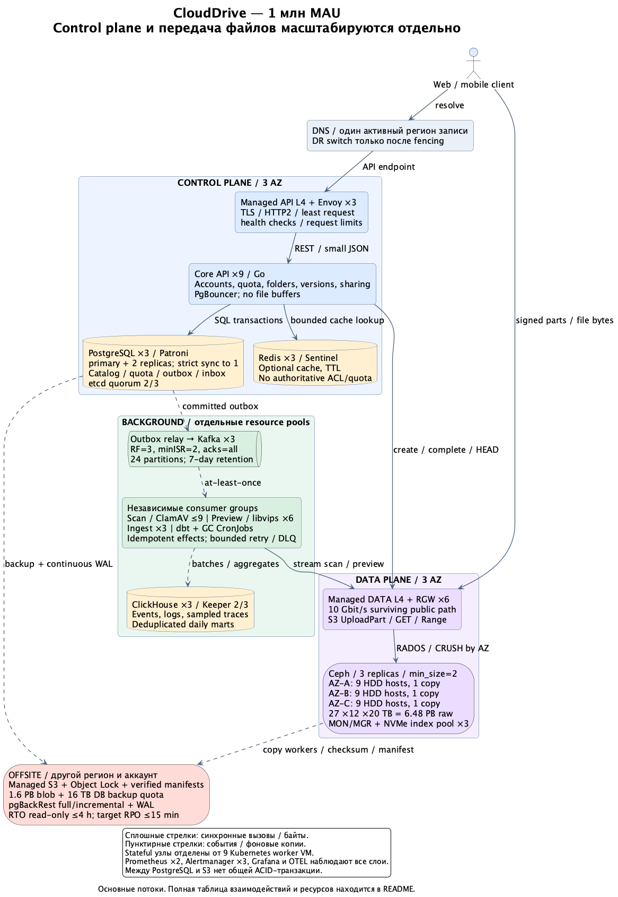
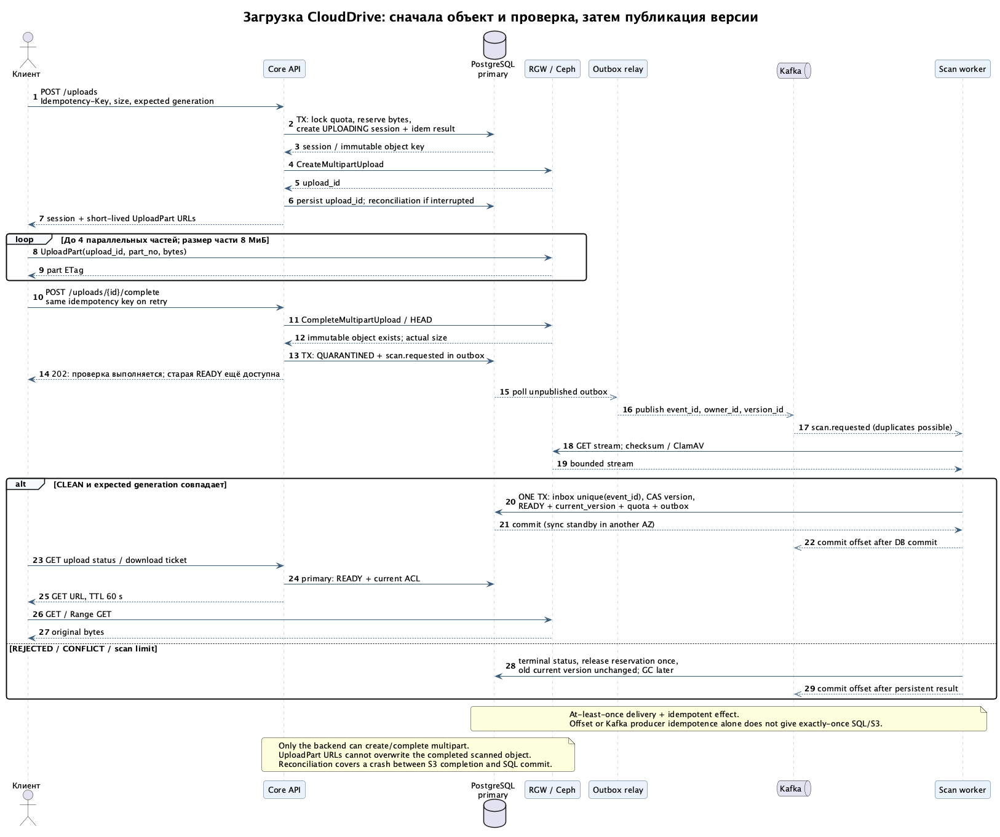

# CloudDrive — архитектура облачного хранилища на 1 млн MAU

Расчётно-пояснительная записка к РК2 курса «Архитектура больших систем».  
Дата расчёта: **23 ноября 2026 года**. Автор: **RahimGulyamov**.

CloudDrive — массовый сервис хранения фотографий и документов с каталогами, версионированием и общими ссылками. Проект охватывает все пять этапов: продукт и нагрузку, балансировку, хранение, программные компоненты и оборудование, взаимодействия и обработку данных, надёжность.

Это **проект архитектуры**. Числа нагрузки и производительности оборудования — проверяемые инженерные оценки; реальные показатели аналогов имеют ссылки на первоисточники. Расчёт выполнен программно, нагрузочный эксперимент с развёрнутым сервисом не проводился. Подтверждение принятой производительности включено в план испытаний.

## Содержание

1. [Сервис, аудитория и границы MVP](#product)
2. [Продуктовые и технические метрики](#load)
3. [Архитектура и балансировка](#architecture)
4. [Системы хранения данных](#storage)
5. [Программные инструменты и аппаратное обеспечение](#software)
6. [Взаимодействие компонентов](#interactions)
7. [Обработка данных](#processing)
8. [Обеспечение надёжности](#reliability)
9. [Ёмкостное планирование, стоимость и развитие](#capacity)
10. [Источники](#sources)
11. [Соответствие критериям РК2 и воспроизведение расчёта](#verification)

<a id="product"></a>
## 1. Сервис, аудитория и границы MVP

### 1.1. Для кого и какую задачу решает сервис

Частным пользователям, студентам и небольшим рабочим группам нужно хранить документы и фотографии, скачивать их с разных устройств, возвращаться к предыдущей версии и передавать файлы по ссылке. В MVP предлагается 5 ГБ места на аккаунт. Среднее фактическое заполнение существенно меньше квоты и задаётся отдельно.

Ключевые свойства задачи: большие двоичные объекты, сотни миллионов записей метаданных, транзакционная квота, асинхронные проверки содержимого, управляемые права доступа и длинные передачи файлов. Поэтому даже при умеренном RPS система требует нескольких типов хранилищ и независимого масштабирования передачи данных и API.

### 1.2. Актуальность и реальные аналоги

| Аналог | Подтверждённые данные и возможности | Что это обосновывает |
| --- | --- | --- |
| Яндекс Диск | В отчёте Яндекса за 2025 год указана месячная аудитория 61.5 млн пользователей [1] | Массовый спрос на хранение файлов; аудитория класса сервисов значительно больше 1 млн |
| Облако Mail | В III квартале 2026 года средняя месячная аудитория в России — 19.9 млн пользователей [2] | Наличие крупного локального рынка и релевантный российский аналог |
| Dropbox | В отчётности за III квартал 2026 года раскрыты более 700 млн зарегистрированных и 18.20 млн платящих пользователей [3] | Существование международного рынка; зарегистрированные и платящие пользователи **не приравниваются к MAU** |

**1 млн MAU — целевой масштаб проектирования, а не установленная аудитория нового продукта.** Для сравнения, это около `1 / 19.9 = 5.03%` месячной аудитории Облака Mail или `1 / 61.5 = 1.63%` аудитории Яндекс Диска. Это проверка порядка величины ниши, а не прогноз захвата рынка. Аудитории аналогов не складываются: они пересекаются, а методики измерения могут различаться. Similarweb не используется.

В присланном списке тем «Облачное хранилище» было свободно. Индивидуальный фокус проекта: транзакционная публикация проверенной версии файла, разделение control/data plane и восстановление согласованного каталога вместе с объектами. Административная запись темы в таблице курса выполняется отдельно от проектирования.

### 1.3. География

Целевая аудитория MVP — пользователи в России. Распределение ниже — **проектное допущение для расчёта**, а не опубликованная географическая статистика аналогов.

| География | Доля MAU | Пользователей | Доля DAU при одинаковой активности |
| --- | --- | --- | --- |
| Центральная и Северо-Западная Россия | 45% | 450 000 | 112 500 |
| Поволжье и Юг | 25% | 250 000 | 62 500 |
| Урал и Сибирь | 25% | 250 000 | 62 500 |
| Дальний Восток | 5% | 50 000 | 12 500 |
| **Всего** | **100%** | **1 000 000** | **250 000** |

Основной регион размещения — три независимые зоны доступности в одном московском регионе, с RTT между зонами по условию выбора площадки не более 2 мс. У зон разные электропитание, стойки и сетевые вводы; три стойки одного зала этому условию не соответствуют. Резервная площадка — другой регион России. Межрегиональные записи асинхронны; единый растянутый на дальние расстояния кластер PostgreSQL/Ceph не проектируется.

Для удалённых пользователей в пользовательскую задержку добавляется WAN RTT. Приложения переиспользуют TLS-соединения, поддерживают Range GET и возобновление частей загрузки. CDN для приватных оригиналов в MVP не требуется: рассчитанный трафик проходит через 10-гигабитный вход, а дополнительный кэш усложняет отзыв доступа. Возврат к CDN предусмотрен при росте международной аудитории или устойчивых горячих публичных ссылках.

### 1.4. Пять функций MVP

| Функция | Граница и критерий корректности |
| --- | --- |
| 1. Загрузка файла и новой версии | Возобновляемый multipart, резервирование квоты, состояние проверки; повтор запроса не создаёт новую версию |
| 2. Каталоги и управление метаданными | Создание, постраничный список, переименование и перемещение; проверка владельца и запрет циклов каталогов |
| 3. Скачивание и просмотр фотографий | Оригинал, Range GET, заранее сформированные JPEG/PNG-превью; ссылка выдаётся после проверки доступа |
| 4. Общие ссылки только на чтение | Случайный токен, срок действия, отзыв; токен хранится хешированным, перебор ограничен |
| 5. Версии и корзина | Предыдущие версии и удалённые файлы хранятся 30 суток; восстановление учитывает квоту и конфликт версий |

Размер файла ограничен **256 МиБ**, размер multipart-части — **8 МиБ**; средний размер файла для модели — **4 МБ**. Такие пределы подходят фотографиям и документам и ограничивают стоимость проверки одного файла. Средние значения не заменяют ограничения: параллельно разрешено до 4 загрузок на пользователя, а подписанные части выдаются ограниченными пачками. Защита от архивных бомб и превышения лимита сканирования описана в разделе 7.

За границей MVP остаются совместное редактирование документов, видеотранскодирование, полнотекстовый/семантический поиск и межпользовательская дедупликация. Загрузка, доступ и квота сохраняют единственного транзакционного владельца — Core API.

<a id="load"></a>
## 2. Продуктовые и технические метрики

### 2.1. Единицы, происхождение допущений и аудитория

Используются десятичные `КБ = 10³ байт`, `МБ = 10⁶`, `ГБ = 10⁹`, `ТБ = 10¹²`, `ПБ = 10¹⁵`. Для RAM и ограничения файла явно используются двоичные ГиБ/МиБ. В сутках 86 400 секунд, расчётный месяц — 30 суток. Десятичные точки сохранены в автоматически построенных таблицах.

| Параметр | Значение | Происхождение / смысл |
| --- | --- | --- |
| Зарегистрированных аккаунтов с сохраняемыми данными | 2 000 000 | Допущение; хранение учитывает и неактивных |
| MAU | 1 000 000 | Требуемый проектный масштаб, сверенный с размерами аналогов |
| DAU / MAU | 25% | Допущение: облачным диском пользуются не каждый день |
| DAU | 250 000 | `MAU × 0.25` |
| Активных дней одного MAU в месяц | 7.5 | `DAU × 30 / MAU` |
| Текущих файлов на зарегистрированного пользователя | 100 | Допущение для первого масштабного этапа; включает аккаунты с малым заполнением |
| Средний размер файла | 4 МБ | Допущение для смеси документов и фото; требуется уточнить по распределению размеров |
| Среднее текущее заполнение аккаунта | 0.4 ГБ | `100 × 4 МБ`; квота 5 ГБ не трактуется как фактически занятое место |
| Каталогов на зарегистрированного пользователя | 10 | Допущение, 20 млн каталогов всего |
| Доля файлов с превью / размер превью | 50% / 0.1 МБ | Допущение для фотографий; видео не обрабатывается |
| Доля новых файлов / перезаписей в загрузках | 60% / 40% | Допущение для расчёта роста и версий |
| Пик / среднее | 6 | Консервативная гипотеза для суточной сезонности, не измеренный коэффициент |
| Горизонт планирования | 12 месяцев, ×1.5 к текущему масштабу | Запас к числу пользователей, объёмам и интенсивности; не применяется повторно поверх рассчитанного роста |
| Сетевой запас | +15% к полезным байтам | HTTP/TLS/TCP, заголовки, умеренные повторы; крупные аварийные ретраи ограничиваются отдельно |

Открытая отчётность аналогов не раскрывает среднее число файлов, действий или DAU именно нужной когорты. Эти параметры не выдаются за реальные данные. Их следует заменить обезличенными агрегатами пилота: распределениями числа/размера файлов, DAU/MAU, RPS по часам и долей перезаписи. Чувствительность к ошибке модели приведена в разделе 9.

Среднее занятие места **по типам данных на зарегистрированный аккаунт**:

| Тип | Штук / аккаунт | ГБ / аккаунт, одна копия |
| --- | --- | --- |
| Оригиналы | 100 | 0.400 |
| Старые версии за 30 суток | 3 | 0.012 |
| Корзина за 30 суток | 1.5 | 0.006 |
| Превью | 50 | 0.005 |
| Незавершённые загрузки / карантин, бюджет | 0.5 | 0.002 |
| **Все двоичные данные** | **155** | **0.425** |
| Профиль / каталоги | 1 / 10 | 0.000001 / 0.000005 без индексов |
| Весь PostgreSQL, включая tombstones, вспомогательные записи и индексы | около 258 строк всех типов | около 0.000342 |

Операционные логи, брокер и мониторинг считаются отдельно по интенсивности и retention: деление их объёма на пользователей не является пользовательской квотой.

### 2.2. Действия пользователей и RPS control plane

Для каждого типа: `actions_day = DAU × actions_per_DAU`, `HTTP_day = actions_day × HTTP_per_action`, `RPS_avg = HTTP_day / 86400`, `RPS_peak = RPS_avg × 6`.

Загрузка состоит из двух запросов Core API — инициализации и завершения. Передача частей идёт прямо в S3/RGW и посчитана отдельно. В строках download/preview API возвращает небольшую ссылку, а не содержимое файла. Обновление сессии — технический запрос, выделенный сверх пяти пользовательских функций. В базовую модель входят также чтения гостями по общим ссылкам: они включены в указанные интенсивности скачивания и не суммируются второй раз.

<!-- BEGIN GENERATED WORKLOAD -->
| Тип control API | Действий / DAU / сутки | HTTP / действие | HTTP / сутки | Средний RPS | Пиковый RPS (×6) |
| --- | --- | --- | --- | --- | --- |
| Каталог и метаданные | 20.0 | 1 | 5 000 000 | 57.87 | 347.22 |
| Загрузка новой версии | 2.0 | 2 | 1 000 000 | 11.57 | 69.44 |
| Получение ссылки на оригинал | 5.0 | 1 | 1 250 000 | 14.47 | 86.81 |
| Получение ссылки на превью | 10.0 | 1 | 2 500 000 | 28.94 | 173.61 |
| Создание / переименование / перемещение | 1.0 | 1 | 250 000 | 2.89 | 17.36 |
| Создание / отзыв общей ссылки | 0.2 | 1 | 50 000 | 0.58 | 3.47 |
| Удаление / восстановление | 0.4 | 1 | 100 000 | 1.16 | 6.94 |
| Просмотр версий и корзины | 0.5 | 1 | 125 000 | 1.45 | 8.68 |
| Вход / обновление сессии | 2.0 | 1 | 500 000 | 5.79 | 34.72 |
| **Всего** |  |  | 10 775 000 | 124.71 | 748.26 |
<!-- END GENERATED WORKLOAD -->

Получаем **10.775 млн запросов API в сутки**, **124.71 RPS в среднем** и **748.26 RPS в пике**. Это умеренный control-plane RPS; выбор нескольких хранилищ обусловлен размером данных и корректностью операций, а не выдуманной необходимостью обрабатывать миллионы RPS.

### 2.3. RPS двоичного контура

Среднее число частей на загрузку принято равным 1.2: большинство файлов укладывается в одну часть, хвост больших файлов повышает среднее. Оно не выводится простым округлением среднего размера файла; потребуется проверка гистограммы размеров.

<!-- BEGIN GENERATED S3 -->
| Тип запросов RGW/S3 | Запросов / сутки | Пиковый RPS, ×6 |
| --- | --- | --- |
| CreateMultipartUpload, backend | 500 000 | 34.72 |
| UploadPart, клиенты | 600 000 | 41.67 |
| CompleteMultipartUpload, backend | 500 000 | 34.72 |
| HEAD после завершения, backend | 500 000 | 34.72 |
| GET оригиналов, клиенты | 1 250 000 | 86.81 |
| GET превью, клиенты | 2 500 000 | 173.61 |
| GET: scan + preview + DR copy | 1 250 000 | 86.81 |
| PUT готовых превью | 250 000 | 17.36 |
| DELETE по истечении срока хранения | 300 000 | 20.83 |
| **Всего** | 7 650 000 | 531.25 |
<!-- END GENERATED S3 -->

Всего **7.65 млн запросов RGW в сутки**, пик **531.25 RPS**, включая внутренние чтения. Асинхронные задачи могут сглаживать собственный пик; расчёт с тем же ×6 даёт запас. Повторное чтение сканером, генератором превью и DR-копировщиком увеличивает **внутренний** трафик и уже включено в S3 RPS.

### 2.4. Входящий и исходящий трафик

`bandwidth_Gbps = bytes_day / 86400 × 8 / 10⁹ × 1.15`. Для пика результат умножается на 6. Размеры control API: запрос 0.5–1 КБ, ответ 0.5–10 КБ в зависимости от операции; точные значения находятся в [модели](model/assumptions.json).

<!-- BEGIN GENERATED TRAFFIC -->
| Поток | Полезных ТБ / сутки | Средних Гбит/с, +15% | Пиковых Гбит/с, ×6 и +15% |
| --- | --- | --- | --- |
| Вход: файлы пользователей | 2.000000 | 0.2130 | 1.2778 |
| Вход: тела control API | 0.006287 | 0.0007 | 0.0040 |
| Выход: скачивание оригиналов | 5.000000 | 0.5324 | 3.1944 |
| Выход: скачивание превью | 0.250000 | 0.0266 | 0.1597 |
| Выход: тела control API | 0.056725 | 0.0060 | 0.0362 |
| **Вход, всего** |  | 0.2136 | 1.2818 |
| **Выход, всего** |  | 0.5651 | 3.3904 |
<!-- END GENERATED TRAFFIC -->

Основные полезные потоки: загрузки `500 000 × 4 МБ = 2 ТБ/сутки`, скачивания `1 250 000 × 4 МБ = 5 ТБ/сутки`, превью `2 500 000 × 0.1 МБ = 0.25 ТБ/сутки`. На годовом запасе внешний пик составляет **1.923 Гбит/с на вход** и **5.086 Гбит/с на выход** с учётом 15%.

Дополнительные внутренние потоки: сканирование — 2 ТБ/сутки чтения, подготовка превью — 1 ТБ/сутки чтения и 0.025 ТБ/сутки записи, копирование новых оригиналов в DR — 2 ТБ/сутки чтения и столько же межрегионального выхода. Репликация трёх копий оригиналов добавляет около 4 ТБ/сутки передачи между OSD сверх первой записи; это не пользовательский выход. Эти потоки не прибавляются к внешнему RPS API.

В годовом пике запись оригиналов с двумя дополнительными копиями даёт около **3.83 Гбит/с** сетевого обмена реплик с тем же запасом. Для штатного обмена и восстановления используются отдельные сетевые лимиты и 100-гигабитные межзональные связи; трафик backfill не может вытеснять пользовательские чтения.

### 2.5. Рост и число сохраняемых объектов

За сутки загружается 500 тыс. файлов/версий: 300 тыс. новых и 200 тыс. замен. До 100 тыс. удалений/восстановлений в модели консервативно считаются новыми удалениями. Чистый прирост: `(300 000 − 100 000) × 4 МБ = 0.8 ТБ/сутки`, **292 ТБ/год**. Текущие оригиналы вырастают с 800 до **1 092 ТБ** при неизменном поведении. Старые версии: `200 000 × 30 × 4 МБ = 24 ТБ`; корзина: `100 000 × 30 × 4 МБ = 12 ТБ`.

Множитель ×1.5 покрывает этот чистый рост 36.5% и дополнительную неопределённость аудитории/размеров. Рассчитанные 292 ТБ **не прибавляются ещё раз** к годовой ёмкости ×1.5. После истечения retention удаляются около 300 тыс. версий/объектов в сутки; это асинхронные DELETE из строки S3, а не дополнительное пользовательское действие.

<a id="architecture"></a>
## 3. Архитектура и балансировка нагрузки

### 3.1. Схема архитектуры



[Масштабируемая SVG-версия](docs/architecture.svg) · [исходник PlantUML](docs/architecture.puml).

Легенда: сплошные стрелки — синхронные обращения и передача файлов; пунктирные — события и фоновые процессы. Показанные экземпляры распределены между тремя AZ; резервные копии находятся в другом регионе и отдельном административном контуре. Стрелка между хранилищами обозначает логическую зависимость восстановления, а не общую транзакцию PostgreSQL и S3.

**Control plane**: L4 → Envoy → Core API → PostgreSQL. Он управляет идентичностью, квотой, состоянием файлов и ссылками. **Data plane**: клиент → отдельный L4/TLS-вход RGW → Ceph. Файлы не проходят через память Core API. Core API, сканер и превью разделены по пулам исполнения; отказ генерации картинки не блокирует просмотр каталога.

Core — модульный Go backend с модулями accounts/quota, namespace, versions/uploads и sharing. Эти функции имеют общие транзакционные инварианты, поэтому не разделяются преждевременно на сетевые микросервисы. Отдельные процессы выделены там, где отличается ресурсная модель или требуется независимая изоляция: передача файлов, сканирование, превью, события и резервное копирование.

### 3.2. Где и как балансируется нагрузка

| Уровень / поток | Алгоритм и инструмент | Причина выбора и альтернатива |
| --- | --- | --- |
| Имя сервиса → основной регион | Авторитетный DNS, TTL 60 с; переключение на DR по проверенному runbook | Один активный регион записи упрощает консистентность; GeoDNS/Anycast для нескольких активных регионов пока не сокращает стоимость или сложность достаточно, чтобы оправдать их |
| Интернет → Envoy, Интернет → RGW | Два логических managed L4-входа с межзональной отказоустойчивостью; распределение TCP-соединений по 5-tuple, исключение нездоровых целей | Разные лимиты короткого API и длинных файловых соединений. Провайдерский L4 сохраняет VIP при отказе экземпляра. Самостоятельный VRRP между AZ потребовал бы общей L2-сети, которую не предполагаем |
| Envoy → Core API | Envoy Gateway, **least request / power of two choices** по активным HTTP-запросам [4] | HTTP/2 держит много запросов в одном соединении: least connections на этом участке хуже отражает нагрузку. Round robin не учитывает медленные запросы. Sticky sessions не нужны: состояние вне pod |
| L4 → RGW | Распределение соединений; ограничение числа потоков и полосы на аккаунт / IP | Все RGW видят один кластер. Хешировать пользователя к одному RGW не требуется, иначе горячая ссылка создаст hotspot; части multipart независимы по соединениям |
| Core / воркеры → PostgreSQL | PgBouncer transaction pooling, выбор только primary через HA-endpoint Patroni | Это маршрутизация роли, а не round robin по primary/replica. Квота, отзыв ссылки и read-after-write требуют свежего состояния |
| Core → Redis | Primary/replica и Sentinel discovery | Кэш помещается в один primary; Redis Cluster сейчас добавил бы сложность без потребности в шардировании |
| События → обработчики | Kafka partitions по `owner_id`, consumer groups | Сохраняется порядок внутри владельца в исходном topic и параллелизм разных владельцев; строгая корректность дополнительно обеспечивается версиями и SQL, а не только порядком сообщений |
| RGW → диски | CRUSH placement, три копии в разных AZ | Хеширование распределяет объекты; это размещение данных с доменами отказа, а не sticky балансировка API |

Managed L4 здесь означает инфраструктурную услугу с проверяемым контрактом: минимум **10 Гбит/с full duplex на оставшемся после отказа пути**, минимум 20 тыс. новых TCP-соединений/с, два независимых VIP для API и данных, active health checks и метрики. Конкретный провайдер выбирается после проверки наличия этих возможностей на площадке; CPU/RAM скрытого балансировщика не выдумываются. Envoy выбран для HTTP/2, маршрутизации запросов, outlier detection и точных retry budgets. Nginx/HAProxy также подходят для базового reverse proxy, но потребовали бы отдельной проверки эквивалентных политик; самостоятельный service mesh для одного Core и нескольких фоновых клиентов избыточен.

### 3.3. Health checks, discovery и отказ зоны

- L4 проверяет endpoint каждые 5 с, timeout 1 с, исключение после трёх неуспехов; восстановление после трёх успехов и плавный ввод нагрузки. TCP accept не считается доказательством готовности приложения.
- `/live` Core проверяет жизнеспособность процесса и не зависит от БД. `/ready` проверяет возможность принять запрос и наличие свободного concurrency budget. Общая недоступность PostgreSQL переводит запись в контролируемые 503; проверка общей зависимости не должна циклически перезапускать все pod.
- Envoy получает endpoint из Kubernetes EndpointSlice через Gateway control plane; data plane продолжает работу с последней корректной конфигурацией при отказе control plane. Пассивное исключение не должно убрать все цели из-за одного общего сбоя БД.
- Перед остановкой pod: убрать readiness, дождаться распространения конфигурации, drain коротких запросов; для RGW — длинный grace period и возможность клиентского resume. PDB не спасает от аварии AZ, поэтому есть topology spread и свободная ёмкость.
- При отказе одной AZ остаются 6 из 9 Core pod, 4 из 6 RGW и кворумы stateful-компонентов. Это посчитано для пика ×1.5, а не только для среднего дня.

DNS TTL не является гарантированным временем переключения: резолверы могут держать старые ответы, а открытые соединения не меняются. Отказ отдельной AZ обрабатывается L4 без DNS-переключения. Для полного региона применяются fencing старой записи, проверка каталога DR и только затем изменение DNS; клиент ограничивает connect timeout и перебирает разрешённые адреса.

### 3.4. Сетевые протоколы и пределы

Снаружи — HTTPS с TLS 1.3 и HTTP/2 для API. Мультиплексирование уменьшает число TCP/TLS handshake, но потеря TCP-пакета способна задержать все HTTP/2 streams этого соединения. Для файлов используется ограниченное число параллельных multipart/Range-запросов; HTTP/1.1 также поддерживается. UDP не используется для надёжной загрузки файлов; HTTP/3 возможен позже, если измерения покажут пользу на мобильных сетях.

Соединения переиспользуются; внутренние доступы к PostgreSQL, Kafka и Ceph проходят по приватным маршрутам без исходящего NAT. Иначе общие SNAT-порты и conntrack стали бы скрытыми лимитами. Наблюдаются число установленных соединений, SYN/retransmits, conntrack и ошибки исчерпания портов. Для API и бинарных передач выделены разные hostnames, connection pools и лимиты.

<a id="storage"></a>
## 4. Системы хранения данных

### 4.1. Категории данных и обоснование выбора

| Данные / доступ | Выбранное хранилище | Почему подходит | Рассмотренная альтернатива и компромисс |
| --- | --- | --- | --- |
| Аккаунты, квоты, каталоги, файлы, ссылки, состояния версий | PostgreSQL 18 | Транзакции и ограничения для квоты, владельца и текущей версии; индексированный доступ по владельцу/каталогу | MongoDB удобен для неоднородных документов, но здесь отношения и многообъектные инварианты важнее гибкой схемы. Cassandra/Scylla усложнят условные изменения и транзакции |
| Оригиналы, старые версии, корзина, карантин, превью | Ceph RGW/RADOS, S3 API, replicated HDD pool | Потоковые объекты и multipart, независимость от API, экономичное дисковое хранение больших объёмов; размещение копий по AZ | Файловая система на одной NAS создаёт узкое место/домен отказа. BLOB в PostgreSQL раздувает WAL и backup. Managed S3 проще в эксплуатации и является реальной альтернативой при приемлемом TCO |
| Внутренние RGW index/log/metadata pools | Отдельный replicated NVMe pool Ceph | Случайный доступ к индексам не конкурирует с объёмным HDD I/O | Хранение bucket index на HDD уменьшает цену, но ухудшает хвост latency при большом числе объектов |
| Горячие дескрипторы, безопасные кэшируемые данные, приблизительные rate counters | Redis primary + 2 replicas, Sentinel | Небольшие KV с TTL, быстрый отказ от необязательного кэша | Memcached достаточно для простого кэша, но не даёт нужных атомарных счётчиков/структур. Критические квота и ACL всё равно находятся в PostgreSQL |
| Outbox / idempotency / обработанные event_id | PostgreSQL в одной транзакции с бизнес-изменением | Безопасный переход между БД и брокером и защита от повторного эффекта | Redis с асинхронной репликацией не является источником истины для этих записей [7] |
| Доменные события и независимые подписчики | Kafka 4.x, 3 brokers/KRaft | Повторное чтение в пределах retention, несколько consumer groups, восстановление фоновых задач после простоя | RabbitMQ quorum queues проще для очереди заданий, но здесь важен replay несколькими подписчиками. NATS JetStream также возможен; отдельная эксплуатационная компетенция не даёт выигрыша при одном уже выбранном журнале |
| Продуктовые события, агрегаты, структурированные логи и sampled traces | ClickHouse, один shard × 3 replicas | Колоночное сжатие и scans по времени; аналитика изолирована от OLTP | PostgreSQL для аналитики конкурировал бы с каталогом за CPU/I/O; Elasticsearch дороже по индексам для простых агрегатов без полнотекстового поиска |
| Метрики | Два Prometheus с независимым локальным TSDB | Метрики хранятся отдельно от ClickHouse, чтобы обнаружить его отказ | TimescaleDB полезна для SQL-временных рядов, но здесь важнее готовые exporters, PromQL и правила alerting |
| Лидерство PostgreSQL / координация ClickHouse | Отдельный etcd для Patroni / ClickHouse Keeper | Кворумное согласование ролей и метаданных соответствующих систем | Состояние лидера в Redis или в локальном файле не защищает от split brain. etcd Kubernetes не переиспользуется приложениями |
| Независимые копии файлов, PostgreSQL backup/WAL, конфигурации | Managed S3 в другом регионе и аккаунте, с версионированием и Object Lock | Переживает удаление/компрометацию первичного контура; отдельные полномочия удаления | Третья онлайн-реплика в том же кластере не защищает от логического удаления. Backup на тот же Ceph не считается DR |

S3-совместимость не означает автоматическую эквивалентность всех возможностей Amazon S3: multipart, checksum, политики, Object Lock и диапазонные GET должны пройти контрактные тесты на выбранной версии Ceph и резервного провайдера. Подписанные URL и их ограниченный срок действия обоснованы моделью bearer-доступа S3 [8].

### 4.2. Двоичные данные: штуки и физическая ёмкость

`physical = logical × 3 replicas × 1.10`. Дополнительные 10% — бюджет BlueStore/RADOS и распределения размеров, который уточняется замерами. Это не свободное место: операционный запас задан отдельно порогом 70% заполнения raw capacity. Количество объектов в таблице — логические S3-объекты/эквиваленты незавершённых загрузок, а не точное количество внутренних RADOS-чанков.

<!-- BEGIN GENERATED BLOBS -->
| Данные | Логических объектов | Одна копия, ТБ | 3 копии + 10%, ТБ | Через год, ×1.5, ТБ физических |
| --- | --- | --- | --- | --- |
| Оригиналы, текущие версии | 200 000 000 | 800.00 | 2 640.00 | 3 960.00 |
| Предыдущие версии, 30 суток | 6 000 000 | 24.00 | 79.20 | 118.80 |
| Корзина, 30 суток | 3 000 000 | 12.00 | 39.60 | 59.40 |
| Превью JPEG/PNG | 100 000 000 | 10.00 | 33.00 | 49.50 |
| Multipart / карантин, бюджет 2 суток входа | 1 000 000 | 4.00 | 13.20 | 19.80 |
| **Итого** | 310 000 000 | 850.00 | 2 805.00 | 4 207.50 |
<!-- END GENERATED BLOBS -->

**27 HDD-хостов × 12 дисков × 20 ТБ = 6 480 ТБ raw.** В каждой из трёх AZ находятся 9 хостов. Заполнение: `2805 / 6480 = 43.29%` сейчас и `4207.5 / 6480 = 64.93%` на горизонте ×1.5. До 70% остаётся около **328.5 ТБ физического** запаса сверх годового плана. Ёмкость 6.48 ПБ не называется полезной пользовательской ёмкостью: она включает три копии, overhead и свободное место.

При потере одной AZ остаётся 18 хостов / 4 320 ТБ и две копии каждого объекта: годовое занятие `1275 × 2 × 1.1 = 2805 ТБ`, или **64.93%** оставшейся ёмкости. Третья копия восстанавливается после возвращения или замены потерянной AZ. Размещать «три независимые AZ-копии» в двух оставшихся зонах невозможно; `min_size` не понижается до 1.

Предыдущие версии, корзина и временные объекты имеют независимый lifecycle. Retention 30 суток относится к пользовательской истории; он не заменяет независимый backup. Обычное удаление сначала создаёт tombstone в SQL; физический GC выполняется после grace period и проверки отсутствия ссылок.

### 4.3. Метаданные PostgreSQL: число строк и ёмкость

Средний размер строки включает tuple overhead и типичную длину полей; индексный бюджет задан отдельно ×2. Эти длины — оценка, а не результат `pg_column_size`. Большие пути и вложенные JSON не копируются в каждую строку, хранятся `parent_id`, короткое имя и идентификаторы.

<!-- BEGIN GENERATED METADATA -->
| Категория PostgreSQL | Записей | Средний размер строки, байт | Heap, ТБ |
| --- | --- | --- | --- |
| Профили и учёт квоты | 2 000 000 | 1000 | 0.002000 |
| Каталоги | 20 000 000 | 500 | 0.010000 |
| Файлы: текущие и tombstones корзины | 203 000 000 | 1000 | 0.203000 |
| Версии: текущие + старые + корзина | 209 000 000 | 500 | 0.104500 |
| Общие ссылки, до 10% текущих файлов | 20 000 000 | 500 | 0.010000 |
| Upload sessions, 1 сутки | 500 000 | 500 | 0.000250 |
| Idempotency keys, 2 суток | 2 800 000 | 500 | 0.001400 |
| Outbox, 7 суток | 11 550 000 | 500 | 0.005775 |
| Inbox четырёх обработчиков, 7 суток | 46 200 000 | 100 | 0.004620 |
| **Всего до индексов** |  |  | 0.341545 |
| **Heap + индексы (×2)** |  |  | 0.683090 |
<!-- END GENERATED METADATA -->

Итого **0.683090 ТБ с индексами на один узел**, **1.024635 ТБ** при ×1.5. С 20% запаса на bloat и 0.2 ТБ на WAL/spool: `1.024635 × 1.2 + 0.2 = 1.429562 ТБ` на узел. Выбраны три узла с **2 ТБ NVMe каждый**: primary и две физические реплики. При расчёте суммарной ёмкости три экземпляра считаются отдельно; 6 ТБ выделенного диска — не 6 ТБ логических данных. Outbox включает также результаты scan/preview: 1.65 млн критических событий в сутки. Inbox рассчитан с запасом как четыре обработчика этого потока; SQL-tombstones удалённых файлов сохраняются до окончания корзины.

Основные сущности: `users`, `folders`, `files`, `versions`, `shares`, `upload_sessions`, `idempotency`, `outbox`, `inbox`. Квота хранит `used_bytes` и `reserved_bytes`; соответствующая строка блокируется при резервировании. `files.current_version_id` указывает только на проверенную READY-версию. Один immutable `object_key` соответствует одной версии. Обновление указателя использует ожидаемый `generation`, чтобы два конкурентных upload не затёрли результат друг друга.

Индексы: `(owner_id, parent_id, name, id)` для keyset pagination каталога; `(owner_id, file_id, created_at DESC)` для версий; уникальный `token_hash` для общих ссылок; уникальный `(owner_id, operation, idempotency_key)`; `(handler, event_id)` для inbox; частичный индекс outbox по необработанным событиям. Перемещение папок требует транзакционной проверки потомков и порядка блокировок; глубина дерева ограничена 32, размер страницы — 100 элементов.

Таблицы больших файлов/версий — 32 hash-партиции по `owner_id` **внутри одного primary**, а не 32 физических шарда. При партиционировании первичные и уникальные ключи включают `owner_id`, и внешние ключи используют составные идентификаторы. Время для TTL-таблиц партиционируется отдельно. Второй физический shard вводится только по измеренному ограничению primary; он потребует миграции владельцев и обработки межшардовых операций. Публичная ссылка содержит серверно проверяемый routing hint владельца, чтобы не обходить все шарды при будущем разделении.

### 4.4. Остальные объёмы и ресурсы хранения

| Хранилище | Основание оценки, одна копия | Репликация / рост / выделение |
| --- | --- | --- |
| Быстрые RGW metadata/index pools | Около 310 млн объектов × 300 байт ≈ 0.093 ТБ; округлено до 0.1 ТБ | 0.33 ТБ с 3 копиями и 10%; 0.495 ТБ при ×1.5. Три NVMe OSD по 1.92 ТБ дают 5.76 ТБ raw; дополнительно WAL/DB HDD OSD находятся на своих хостах |
| Redis | До 1 млн дескрипторов × 2 КБ × 2 на накладные расходы = 4 ГБ + до 1 ГБ счётчиков; базово до 5 ГБ | При ×1.5 до 7.5 ГБ данных; `maxmemory=8 GiB`, 16 GiB RAM на узел ×3. Точный overhead проверяется `MEMORY USAGE` |
| Kafka | 5.4 млн событий/сутки × 1 КБ × 7 суток = 0.0378 ТБ | ×3 = 0.1134 ТБ; ×1.5 и двукратный бюджет retry/DLQ = 0.3402 ТБ. Три broker-диска по 0.5 ТБ дают 1.5 ТБ raw, запас на сегменты и backlog |
| ClickHouse, продуктовые события | 5.4 млн × 400 байт / сжатие 4 × 90 суток = 0.0486 ТБ | ×3 = 0.1458 ТБ; ×1.5 = 0.2187 ТБ, отдельно от логов/трассировок |
| ClickHouse, логи и traces | Около 18.425 млн HTTP-запросов/сутки × 500 байт / 4 × 14 суток = 0.032244 ТБ логов; 1% traces × 5 КБ × 7 суток ≈ 0.006449 ТБ | Всего с продуктовой аналитикой около 0.262 ТБ в трёх копиях сейчас и 0.393 ТБ при ×1.5; ещё ×2 на merges/временные результаты ≈ 0.786 ТБ. Выделено 3 × 1 ТБ SSD |
| Prometheus | 20 тыс. активных samples/с × 2 байта × 14 суток ≈ 0.0484 ТБ на реплику; ×2 на индекс и WAL | Две независимые реплики по 0.5 ТБ SSD; кардинальность ограничивается. Метки file_id/user_id не создаются |
| etcd / Keeper | До 10 млн служебных записей малого размера; бюджет до 10 ГБ на процесс | Три узла, отдельные дисковые квоты; по 100 ГБ NVMe на узел для WAL/snapshot и запаса, без файлового контента |
| Backup файлов в другом регионе | `(800 + 24 + 12) ТБ × 1.2 = 1003.2 ТБ` логических; +20% на независимый retention/GC | При ×1.5 = **1504.8 ТБ**; контрактная квота 1.6 ПБ. Физические копии managed S3 скрыты провайдером и не включаются в 6.48 ПБ primary raw |
| PostgreSQL backup + WAL | Около 1 ТБ каталога, weekly full / daily incremental, непрерывный WAL, срок 35 суток | Бюджет **16 ТБ** в DR: 5 полных копий ×1.1 ТБ +35×0.1 ТБ WAL +35×0.08 ТБ incremental ≈11.8 ТБ до дополнительного резерва. Компрессия для гарантированного попадания в квоту не предполагается; реальные WAL/changed blocks измеряются в пилоте |

События Kafka: 0.9 млн доменных изменений + 0.5 млн результатов scan + 0.25 млн результатов preview + 3.75 млн успешных скачиваний/просмотров = **5.4 млн/сутки**, **62.5 events/s в среднем**, **375 в пике** и **562.5 при ×1.5**. Брокер нужен для изоляции и replay, а не из-за экстремальной пропускной способности. Тела файлов в сообщения не помещаются.

### 4.5. Эксплуатация каждого хранилища

| Система | Наблюдаемость и ранние сигналы | Надёжность и backup | Масштабирование и эксплуатация |
| --- | --- | --- | --- |
| PostgreSQL | postgres_exporter, `pg_stat_statements`, p95/p99 SQL, lock wait, deadlocks, age XID, WAL bytes/s, replica lag, replication-slot bytes, bloat, disk latency | Patroni `synchronous_mode=true`, `synchronous_mode_strict=true`, одна sync replica в другой AZ; три DCS etcd; fencing старого primary. pgBackRest PITR с offsite-копией; ежемесячное restore | PgBouncer, не более 200 server connections суммарно, statement timeout по классу; `shared_buffers` около 32 GiB из 128. Настройка autovacuum по большим таблицам; concurrent index builds; TTL удаляется пакетами/партициями, не огромным DELETE |
| Ceph HDD / NVMe | Ceph mgr exporter: slow ops, degraded/undersized PG, nearfull, p99 OSD/RGW, disk latency, recovery bandwidth, bucket-index skew, checksum/scrub errors | CRUSH failure-domain AZ, `size=3`, `min_size=2`; MON quorum 2/3. Отдельные SMART и deep-scrub; offsite копия с независимыми credentials | PG autoscaler, bucket-index sharding, ограничение scrub/backfill в пик. Добавление хостов по 3, по одному в AZ. `osd_memory_target=6 GiB`; NVMe WAL/DB для HDD; не смешивать scan с OSD [9][10] |
| Redis | exporter: hit ratio, evictions, RSS vs maxmemory, latency, replication lag, failovers | Sentinel quorum 2/3, AOF/RDB допустимы для ускорения прогрева; потеря данных кэша допустима, восстановление из PostgreSQL | `allkeys-lfu`, TTL с jitter ±20%, request coalescing для горячего ключа. Нельзя кэшировать разрешение доступа как окончательную истину; при отказе bounded bypass к primary |
| Kafka | consumer lag **в секундах** и сообщениях, oldest pending age, ISR, offline partitions, disk, producer errors, retry/DLQ rate | RF=3, `min.insync.replicas=2`, `acks=all`, idempotent producer; unclean leader election выключен. Доменные задания восстанавливаются из outbox/SQL; аналитические сырые данные периодически архивируются | 24 partitions основных topics с ключом owner_id; partition count не меняется бесконтрольно, чтобы не менять порядок владельца. Ограничить fetch, batch, retention, DLQ; не создавать topic на пользователя [11] |
| ClickHouse | `system.query_log`, replicas/replication_queue, parts, merge backlog, disk, ingest lag | ReplicatedMergeTree ×3 в разных AZ, Keeper 2/3; nightly backup схем/агрегатов в DR, сырые события архивируются для replay | Partition by day, ORDER BY `(event_type, event_date, owner_bucket, event_id)`; batch 1–10 тыс. строк, TTL. Отдельные users/quotas для logs и product queries; при merges/IO перегрузе аналитика отключается первой [12] |
| Prometheus | Проверки scrape gap, rule evaluation, TSDB series/sample count, disk, remote heartbeat | Две независимые реплики, Alertmanager 3; конфигурация и rules в Git/DR. Потеря части исторических метрик не ведёт к потере пользовательских данных | 15-секундный scrape, 14-day retention, label allowlist; увеличить scrape interval для низкоприоритетных collectors при перегрузке |
| etcd / Keeper | Leader changes, peer RTT, fsync p99, quorum health, db size | По одному участнику каждого кворума в AZ; периодические snapshots в DR; восстановление без создания двух лидеров | SSD, ограничение размеров, compact/defrag etcd по регламенту; масштабировать только при измеренной потребности, чётное число участников не добавляет устойчивости |
| Offsite S3 / pgBackRest | Oldest unprotected version age, manifest lag, last valid backup time, restore duration, checksum verification, failed DELETE/GC | Отдельный аккаунт и KMS-ключи, versioning/Object Lock, ограниченные delete-права, подтверждённый recovery checkpoint | Отдельные квоты ingress/egress, lifecycle после retention; проверять не только успешный API backup, но возможность прочитать и связать файл с восстановленным каталогом |

Синхронная репликация PostgreSQL подтверждает сохранение WAL на выбранной реплике; она не делает любую произвольную read replica немедленно свежей [5]. Patroni strict mode выбран осознанно: при потере всех допустимых sync replicas запись останавливается [6]. Таймаут commit означает неопределённый исход; клиент повторяет операцию с тем же ключом идемпотентности, а не считает её автоматически отменённой.

<a id="software"></a>
## 5. Программные инструменты и аппаратное обеспечение

### 5.1. Языки, runtime и фреймворки по компонентам

| Компонент и роль | Язык / runtime / инструменты | Обоснование и альтернативы |
| --- | --- | --- |
| Core API: аккаунт, каталог, квота, версии, sharing | Go, gc runtime; `net/http` + chi, `pgx`, `sqlc`, `go-redis`, S3 SDK, OpenAPI | Goroutines подходят множеству ожидающих I/O запросов; streaming исключает аллокацию целого файла. Небольшой REST-контракт и SQL-инварианты понятнее тяжёлого ORM. Java/Spring столь же возможен, но требует большей настройки heap и пулов; Python удобен для управления, но не даёт преимущества для долгоживущего сетевого API |
| Входной L7 | Envoy Gateway/Envoy, C++ runtime | Готовые HTTP/2, TLS, outlier detection, request limits; собственный reverse proxy не разрабатывается |
| S3 data plane | Ceph RGW/RADOS, штатные C++ daemons | Готовые multipart, Range, CRUSH и replication; Core не повторяет реализацию object storage |
| Outbox relay / inbox consumers / копирование в DR | Go, `pgx`, `franz-go`, S3 SDK, bounded worker pools | Ключевой расход — сеть и ожидание; стриминговое копирование с фиксированными буферами. Ограничивается число goroutines и DB-коннектов; Kafka batch сжимается, JSON-события имеют версию схемы |
| Проверка файлов | Go worker + постоянно запущенный ClamAV `clamd` (C/C++), Unix socket | База сигнатур не загружается на каждый файл; файл читается потоком, отдельный процесс/ресурсный пул защищает API [13]. Синхронный запуск shell scanner внутри API ухудшил бы tail latency |
| Превью JPEG/PNG | Go worker + libvips (C) | Demand-driven обработка ограничивает память; concurrency и число декодированных пикселей ограничиваются [14]. ImageMagick даёт более широкий форматный охват, который MVP не требует |
| Потоковые события / выгрузки | Go consumers, JSON Schema, ClickHouse native client | При пике менее 600 событий/с достаточно stateless consumers и батчей. Flink/Kafka Streams полезны при больших stateful windows/joins; сейчас их coordinator/state/checkpoints создавали бы лишнюю операционную нагрузку |
| Суточные витрины и проверка качества | SQL, dbt-clickhouse в Python runtime; Kubernetes CronJob | SQL-ELT в аналитическом хранилище; тесты качества рядом с моделью. Airflow оправдан после появления сложного DAG/многочисленных зависимых задач |
| Очистка, reconciliation, проверки backup | Go, Kubernetes CronJobs и PostgreSQL advisory lock | Простое расписание и lease в БД; CronJob не гарантирует отсутствие повторов, поэтому каждая операция идемпотентна |
| Наблюдаемость | OpenTelemetry Collector / Vector, Prometheus, Grafana, Alertmanager | OTLP для traces, JSON logs и scrape exporters; инструменты имеют независимые resource limits. Ошибка при отправке telemetry не роняет пользовательский запрос |

В Go размер heap ограничивается `GOMEMLIMIT` ниже cgroup memory limit, потоки/пулы согласуются с CPU limit, а крупные буферы переиспользуются. Регулярно снимаются CPU/heap/block profiles. Передача бинарных данных через JSON/base64 не используется. Внешний API — компактный JSON, внутренние доменные сообщения — JSON Schema с явной версией; стоимость сериализации при менее 1.2 тыс. API RPS не оправдывает введение gRPC только ради экономии байтов.

### 5.2. Аппаратные ресурсы stateful-систем

`vCPU` — выделенный виртуальный поток; для bare metal указаны физические ядра отдельно. Для БД важны стабильные fsync/IOPS и отсутствие CPU steal, поэтому выбираются выделенные ресурсы, SSD/NVMe с power-loss protection и RAM ECC. Указанные IOPS/throughput — **минимальные цели при выборе и испытании**, а не измеренные характеристики модели сервера.

| Система | Количество × ресурс одного узла | Диск и сеть | Почему такой ресурс |
| --- | --- | --- | --- |
| PostgreSQL | 3 × 16 vCPU, 128 GiB | 2 ТБ usable NVMe, ≥10 тыс. random IOPS, fsync p99 ≤5 мс; 10 GbE, RTT межзонально ≤2 мс | Около 1.4 ТБ с годовым запасом и WAL; RAM для горячих индексов/page cache, NVMe для random access и WAL. Три узла нужны для отказа одной AZ |
| Ceph HDD OSD | 27 × 24 физических ядра / 48 threads, 192 GiB ECC | 12 ×20 ТБ enterprise HDD на хост; отдельный зеркальный boot; 4 ×7.68 ТБ NVMe как две mirror-пары для WAL/DB; 2×25 GbE к разным ToR | 6.48 ПБ raw определены ёмкостью. 12 OSD ×6 GiB ×2 =144 GiB ниже 192 GiB RAM. На каждую группу 6 HDD отведено ≥4.8 ТБ WAL/DB из usable 7.68 ТБ пары: это 4% их 120 ТБ, согласно рекомендации для RGW [22]. HDD — ёмкость, NVMe — metadata I/O |
| Ceph MON/MGR + быстрый OSD | 3 ×8 vCPU, 128 GiB | По 1.92 ТБ NVMe OSD на узел для index/metadata pool; отдельные boot/MON-диски; 10 GbE | MON quorum 2/3; RAM с запасом для кластера 324 HDD OSD. MGR активный + standby; RGW вынесен в приложение |
| Redis + Sentinel | 3 ×2 vCPU, 16 GiB | 100 ГБ SSD; 10 GbE | Один primary + две копии; maxmemory 8 GiB ниже RAM, место для fork/COW и replication buffers. Фактический размер одного KV уточняется |
| Kafka brokers + KRaft controllers | 3 ×4 vCPU, 16 GiB | По 0.5 ТБ SSD, ≥200 МБ/с последовательной записи; 10 GbE | 0.34 ТБ данных суммарно в стресс-бюджете; modest JVM heap около 4 GiB, остальное page cache. Совмещённая роль controller допустима при таком небольшом кластере |
| ClickHouse | 3 ×8 vCPU, 32 GiB | По 1 ТБ SSD, ≥500 МБ/с, 10 GbE | Один shard в трёх AZ; <0.8 ТБ суммарного расчётного объёма с merges, запас для backfill и тяжёлых scans; query quotas отделяют аналитику от ingest |
| DCS PostgreSQL + Keeper | 3 ×4 vCPU, 8 GiB | По 100 ГБ NVMe, fsync p99 ≤5 мс; 10 GbE | На каждом узле раздельные etcd и Keeper с квотами; один участник каждого кворума в AZ. Эти процессы не используют etcd control plane Kubernetes |
| Prometheus | 2 ×4 vCPU, 16 GiB | По 0.5 ТБ SSD, 10 GbE | Независимая запись samples, запас на индекс/WAL и рост; две реплики в разных AZ |
| DR managed S3 | Квоты: 1.6 ПБ файлов +16 ТБ PostgreSQL backup/WAL | Выделенный межрегиональный путь 10 Гбит/с; API-квота ≥1 тыс. запросов/с | CPU/RAM и физическая репликация — ответственность провайдера; оцениваются контрактные limits и логическая ёмкость, а не неизвестное железо |

NVMe WAL/DB не добавляется к полезной HDD-ёмкости: это служебный ресурс. Зеркалирование NVMe-пар предотвращает потерю шести локальных DB при единичном отказе NVMe, но не заменяет межзональные копии. Объём индексов RGW и DB/WAL проверяется отдельно на реальном профиле объектов. Цели дискового I/O проверяются `fio` на тестовой площадке с профилем соответствующей системы, а не разрушительным тестом поверх рабочей БД.

pgBackRest исполняется на подходящей PostgreSQL standby с cap до 4 vCPU /8 GiB и ограничением I/O вне пика; эти ресурсы входят в её 16 vCPU /128 GiB и не считаются новой VM. При сокращении числа безопасных реплик приоритет получает репликация, backup при необходимости переносится/замедляется; непрерывная защита WAL контролируется отдельно.

### 5.3. Контейнеры приложений и фоновой обработки

Приложения работают на **9 worker VM ×16 vCPU / 64 GiB / 0.5 ТБ SSD /10 GbE**: по три VM в каждой AZ. Control plane Kubernetes — отдельно 3 ×4 vCPU /8 GiB /100 ГБ SSD. Stateful БД, Kafka и Ceph размещаются на отдельных узлах: сканирование файлов не должно конкурировать с `fsync` и восстановлением реплик.

В таблице — верхняя штатная конфигурация для расчётного пика и готовности к потере AZ; scan может уменьшаться до трёх pod вне пика. CPU/RAM — reservations, на основе которых проверяется размещение, а не обещание постоянно высокой загрузки.

| Компонент | Pod / задачи | vCPU / GiB на экземпляр | Локальный диск / сеть | Оценка и предел |
| --- | --- | --- | --- | --- |
| Core API + PgBouncer sidecar | 9 | 1 /2 | До 1 ГБ tmp, 1 GbE budget | Цель 250 RPS/pod: при потере AZ 6×250=1500 RPS > годового пика 1122.40. Пул на pod до 16 server connections; всего до 144, ниже лимита 200 |
| Envoy Gateway data plane | 3 | 2 /2 | 1 ГБ; по 10 GbE VM | После потери AZ два экземпляра обслуживают до 1122.40 control RPS; ответы API дают менее 0.06 Гбит/с в годовом пике. Бинарные файлы идут через отдельный data-вход напрямую в RGW |
| RGW | 6 | 2 /8 | До 10 ГБ tmp, ≥3 Гбит/с streaming на pod в испытании | Четыре после отказа AZ, суммарно ≥12 Гбит/с; квоты учитывают пользовательские и внутренние чтения. C++-буферы и TLS дают основной RAM/CPU overhead |
| Scan / ClamAV | До 9 | 4 /8 | 10 ГБ ephemeral, без долговременных копий; поток из RGW | 36 vCPU, после отказа AZ —24. Требуется не менее 20 МБ/с на ядро на принятой смеси; расчёт в разделе 7 |
| Превью libvips | 6 | 1 /2 | 2 ГБ ephemeral, 1 GbE budget | После отказа AZ 4 ядра; ограничение 20 Мп и одной тяжёлой задачи на экземпляр |
| Outbox relay / восстановитель событий | 3 | 1 /1 | 1 ГБ, 1 GbE budget | Один логический набор работ, SKIP LOCKED/lease, batch 100; повторы допускаются |
| Consumers и ClickHouse ingest | 3 | 2 /4 | 10 ГБ bounded spool, 1 GbE budget | Batched JSON→native rows; целевой ingest ≥2 тыс. событий/с суммарно после отказа AZ |
| DR copy workers | 3 | 2 /4 | 10 ГБ bounded spool, 10 GbE VM | После отказа AZ два worker; суммарная цель ≥250 МБ/с, выше годового пика входа 208.33 МБ/с |
| ELT / GC / reconciliation CronJobs | До 2 одновременно | 2 /4 | До 10 ГБ; 1 GbE budget | Низкий priority class; concurrency policy + SQL lease; CPU cap не позволяет вытеснить API |
| OTEL Collectors | 3 | 2 /2 | По 10 ГБ bounded queue, 1 GbE budget | Пакетная telemetry; потеря аналитики допускается раньше потери control plane |
| Grafana | 2 | 1 /1 | Конфигурация из Git, 1 ГБ | Разные AZ, доступ к независимым Prometheus |
| Alertmanager | 3 | 0.5 /0.5 | По 1 ГБ state | Кластерные уведомления и dedup; отдельный synthetic heartbeat |
| Vector agents | 9 | 0.2 /0.25 | До 10 ГБ spool / VM | Логи каждого worker, обязательное удаление токенов/URL credentials |

Суммарные верхние reservations workloads — **99.3 vCPU и 202.75 GiB**; плюс резерв ОС/kubelet по 2 vCPU и 8 GiB на VM = **117.3 vCPU и 274.75 GiB** из доступных 144 /576. В пике резервируется около 81.5% CPU. При равномерном topology spread после потери AZ остаются 96 vCPU /384 GiB; две трети workloads вместе с резервом занимают около 78.2 vCPU /183.2 GiB. Замена потерянных pod не должна бесконтрольно возвращать прежнее количество на оставшиеся узлы: admission/priority поддерживают рассчитанный профиль и сначала ограничивают фоновые задачи.

GPU/TPU не требуются: в MVP нет ML-инференса. Проверка сигнатур и resize изображений используют CPU. Наличие AI-инструментов не является самостоятельной целью; при добавлении semantic search потребуется отдельный бюджет эмбеддингов и согласование модели доступа к приватным данным.

### 5.4. Тестирование, виртуализация и CI/CD

- **Unit:** `go test`, race detector, property/fuzz tests для дерева каталогов, квоты, ключей идемпотентности и переходов состояний. Проверяется неизменность квоты при повторах и запрет доступа к чужому owner.
- **Integration:** Testcontainers с PostgreSQL, Redis и Kafka; S3 contract suite на отдельном Ceph RGW стенде. Mock или MinIO не подтверждают поведение Ceph. Сценарии включают падение relay между publish и mark-sent, повтор scan, конфликт двух upload, истечение TTL ссылки и сбой CompleteMultipart.
- **Load:** k6 arrival-rate сценарии из таблицы действий, включая control API и прямые uploads/Range GET. Набор объектов как минимум больше RAM кэша и включает распределение размеров, hot shares и холодные каталоги. Отдельно измеряются клиенты/серверы и время до/после TLS.
- **Профилирование:** Go pprof, `EXPLAIN (ANALYZE, BUFFERS)` в тестовом окружении, `pg_stat_statements`, Ceph perf counters, `fio` для дисков и `iperf3` для выделенной сети. Смотрим p99, CPU steal, GC pauses, disk queue и retries, а не только максимальный RPS.
- **Виртуализация:** VM/KVM у провайдера даёт изоляцию арендаторов и предсказуемые CPU/RAM; контейнеры Docker/OCI упрощают воспроизводимую сборку. Kubernetes нужен для нескольких отдельно масштабируемых worker pools, topology spread, probes и безопасного rollout. Stateful данные отделены от ephemeral pod disks.
- **CI/CD:** GitHub Actions: lint → unit/race → integration → build OCI → SBOM и scanner → registry. Образы адресуются digest, deployment — Helm через Argo CD. Secrets поступают через ограниченные workload identities/secret store, не из публичного Git.
- **Rollout:** 5% canary →25%→100% с проверкой ошибок, p99 и lag; при превышении error-budget burn — rollback приложения. Схема БД меняется expand→backfill→switch→contract; обратно несовместимые DDL не откатываются простым rollback контейнера. Миграции работают с lock timeout и ограничением batch.

В этой работе проверены **арифметика модели и согласованность артефактов**; перечисленные испытания — критерии приёмки реализации, результаты измерений не выдумываются.

<a id="interactions"></a>
## 6. Взаимодействие компонентов

### 6.1. Сводная таблица всех основных потоков

| Кто → кому | Тип / протокол | Для чего и почему | Надёжность, ограничение |
| --- | --- | --- | --- |
| Клиент → L4 → Envoy → Core | Синхронно, HTTPS REST/JSON, OpenAPI | Нужен немедленный ответ каталога, квоты и прав | Общий deadline короткого запроса 800 мс, Idempotency-Key на изменениях |
| Core → PgBouncer → PostgreSQL primary | Синхронно, PostgreSQL/TLS | Квота/namespace/current version должны изменяться атомарно | Бюджет SQL обычно ≤150 мс; pool wait ≤50 мс; максимум 200 server connections |
| Core → Redis | Синхронно, RESP/TLS | Необязательные дескрипторы/кэш | Timeout 10 мс, без retry в запросе; при проблеме bounded fallback к SQL |
| Core → RGW | Синхронно, S3/HTTPS | Создание/завершение multipart, HEAD, короткая подпись доступа | Completion отдельный deadline до 5 с; повтор только с сохранённым upload_id и известным состоянием |
| Клиент → data L4 → RGW | Синхронный поток, HTTPS S3 UploadPart / Range GET | Бинарные байты не нагружают Core | Connect timeout 2 с, idle timeout 30 с, deadline части 120 с, до 4 частей параллельно; resume вместо загрузки заново |
| RGW → RADOS OSD / MON | Синхронные внутренние протоколы Ceph | Запись/чтение объекта и placement | Private network, три AZ, min_size=2; bounded recovery |
| PostgreSQL outbox → relay → Kafka | Асинхронно, SQL polling + Kafka protocol/TLS | Устойчивый publish после бизнес-транзакции | At-least-once, producer idempotence; lease и unique event_id |
| Kafka → scan / preview / analytics groups | Асинхронно, pull consumers | Независимые ресурсы и повторное чтение | Offset commit после устойчивого эффекта; retry topics, DLQ, inbox |
| Scan / preview → RGW и Core tables | S3 потоки + транзакционные SQL через общий код обработки | Проверка версии, вычисление результата, публикация READY | Worker имеет права только на свою state transition; лимиты CPU/RAM/размера, compare-and-set |
| RGW access logs → Vector/collector → Kafka | Асинхронно, JSON logs / Kafka | Фактические успешные downloads для аналитики | Bounded spool; потеря бизнес-аналитики не блокирует скачивание; это отдельный telemetry SLO |
| Ingest → ClickHouse | Асинхронно, native protocol/TLS, batch | OLAP отдельно от OLTP | Ограниченный batch, event_id для дедупликации, backpressure по merge/disk |
| dbt / CronJobs → ClickHouse / PostgreSQL / RGW | Отложенно, SQL/S3 | Суточные витрины, GC, reconciliation | Lease, идемпотентность, низкий priority и resource cap |
| DR copy → primary RGW → offsite S3 | Асинхронно, S3 GET/PUT + manifest | Копирование immutable объектов и проверка связи с каталогом | Повторяемый `(version_id, checksum)`; checkpoint публикуется только после проверки объектов |
| PostgreSQL → replicas / pgBackRest → offsite S3 | Streaming WAL / backup | HA и PITR | Sync внутри региона, архивирование WAL и backup между регионами |
| Patroni → etcd; ClickHouse → Keeper | Синхронная кворумная координация | Лидерство/репликация | Отдельные от пользовательского API кворумы, запрет promotion без fencing |
| Компоненты/hosts → collectors / Prometheus → Grafana/Alertmanager | Асинхронная telemetry / scrape | Метрики, логи, traces, уведомления | Queue cap, sampling, независимый внешний heartbeat |

REST выбран из-за простого клиентского контракта и небольшого control трафика. GraphQL не нужен для пяти ограниченных функций и усложняет стоимость произвольных запросов. Внутренние сетевые микросервисы с многочисленными мелкими gRPC-вызовами не вводятся: общие инварианты остаются в Core. Если позднее выделится самостоятельный quota service, typed gRPC с propagation deadline станет обоснованным выбором.

### 6.2. Путь загрузки и транзакционная публикация



[Исходник последовательности PlantUML](docs/upload-sequence.puml).

1. Клиент вызывает `POST /uploads` с Idempotency-Key и размером. В SQL-транзакции блокируется квота, проверяется `used + reserved + requested ≤ quota`, создаются upload session и резерв. Повтор с тем же ключом/телом возвращает прежний session; с другим телом —409.
2. Backend создаёт уникальные `object_key` и `upload_id`. Клиент получает подписи **только UploadPart для этого upload_id**, короткими пачками и со сроком 15 минут. Create/CompleteMultipartUpload остаются у backend. Поэтому после completion клиент не может теми же подписями перезаписать уже просканированный объект.
3. Клиент передаёт части напрямую в RGW. Повтор части с тем же номером допустим до completion; можно запросить список полученных частей и продолжить. Core никогда не принимает файл в своё JSON-тело.
4. `POST /uploads/{id}/complete` завершает multipart, HEAD проверяет фактический размер. В транзакции session становится QUARANTINED и создаётся `scan.requested` в outbox. Внешние S3-вызовы не удерживают SQL row lock. Ошибка между S3 completion и SQL commit устраняется reconciliation по immutable key/upload state.
5. Relay отправляет outbox в Kafka. Scan worker читает объект потоком, сверяет checksum и проверяет содержимое. При успешной проверке транзакция CAS по `generation` переводит версию в READY, меняет `current_version_id`, переводит резерв в занятую квоту, сохраняет inbox/event и новый outbox. Если за время проверки появилась конкурентная версия, создаётся явный конфликт; старая актуальная версия не перезаписывается молча.
6. В ответ на complete клиент получает **202 со статусом проверки**, а не ложное обещание, что файл уже опубликован. Каталог сохраняет предыдущую READY-версию до успешного шага 5. При отказе проверки —REJECTED с причиной и освобождением резерва; физическое удаление идёт через GC. Повтор результата scan не списывает квоту второй раз.
7. Превью создаётся после READY, записывается по ключу `(version_id, transform_version)` и может появиться позднее. Отсутствие превью не блокирует оригинал.

Состояния: `UPLOADING → QUARANTINED → READY` либо `REJECTED/CONFLICT/EXPIRED`. Успех опубликованной версии означает наличие объекта и подтверждённую SQL-транзакцию. Единой распределённой транзакции PostgreSQL+S3 нет; корректность обеспечивается порядком переходов, неизменяемыми объектами, outbox и периодической сверкой.

### 6.3. Гарантии доставки, порядок и повторные обработки

- Доставка доменных событий — **at-least-once**. Relay может упасть после Kafka publish до `published_at`; повтор будет с тем же `event_id`.
- Kafka idempotent producer уменьшает дубли при повторах producer, но не даёт exactly-once эффекта в PostgreSQL/S3. Поэтому обработчик в одной SQL-транзакции делает `INSERT inbox(handler,event_id)` и изменение состояния; конфликт unique означает уже выполненный эффект. Offset подтверждается после commit.
- Копирование и превью детерминированы immutable key и версией преобразования. При падении после PUT до SQL-коммита повтор проверяет объект/хеш и завершает прежнюю работу. Временные результаты с неподтверждённым manifest удаляются отложенно.
- Ключ `owner_id` даёт порядок внутри partition исходного topic. Retry topic может нарушить порядок; handler сравнивает `generation`/статус и не применяет устаревшее событие. Для квоты нужна SQL-блокировка, а не вера в Kafka ordering.
- Transient retry: 1 с →5 с →30 с →2 мин →10 мин с jitter. Максимум 5 повторов, затем DLQ; ошибки формата/неподдерживаемый файл идут сразу в terminal status. DLQ имеет владельца, метрику oldest age и процедуру исправление→повтор с тем же event_id.
- Retention Kafka —7 суток; outbox очищается только после подтверждённых критических consumer checkpoints и допустимого срока. При аварии дольше retention scan восстанавливает задания из QUARANTINED SQL rows, preview —из READY без производного объекта. Необязательные сырые access events при переполнении spool могут теряться по отдельному telemetry SLO.
- Версия события `schema_version` обязательна. Эволюция добавляет необязательные поля; producer не переиспользует значение поля в новом смысле. Неизвестная major version помещается в DLQ, а не молча игнорируется.

### 6.4. Таймауты, дедлайны, идемпотентность и backpressure

Короткий API имеет server deadline **800 мс**: до 50 мс ingress/admission, до 50 мс ожидание DB pool, до 150 мс основной SQL, до 100 мс возможное создание короткого S3 ticket/проверка, до 100 мс обработки/сериализации; остаток — резерв хвоста и одного ограниченного безопасного повтора. Это бюджеты, а не сумма обязательных этапов каждого запроса. Клиент использует общий deadline 2 с с учётом WAN; init/complete с S3 имеют отдельный server deadline 5 с и client deadline 8 с.

Повтор короткого GET разрешён один раз **только на одном уровне**, если остался deadline. Proxy не повторяет изменяющий POST без идемпотентности. Не более 5% дополнительных попыток от исходных запросов в окне; локальные `429/503` и Retry-After помогают избежать retry storm. Для commit timeout клиент запрашивает статус по ключу: неизвестный результат не означает rollback.

На Core — semaphore не более 128 одновременно выполняемых запросов на pod, ограниченная очередь ожидания, лимиты на каталог/page size и owner. На RGW — ограничения новых multipart, общего reserved bytes и потоков; публичная ссылка не получает безлимитную полосу. На Kafka consumer — bounded inflight, pause partition при перегрузе БД, отдельные pools для scan/preview/analytics. При росте QUARANTINED age свыше 2 мин увеличивается scan pool; при приближении к 5 мин новые upload начинают получать 429/Retry-After. Существующие данные продолжают читаться.

<a id="processing"></a>
## 7. Обработка данных

### 7.1. Специализированные инструменты, нагрузка и ресурсы

| Процесс | Инструмент и схема | Расчёт ресурса | Альтернатива / ограничение |
| --- | --- | --- | --- |
| Антивирус и checksum | Go consumer → S3 stream → ClamAV `clamd`; результат + inbox + outbox в SQL | Годовой пик `2 ТБ/сутки /86400 ×6 ×1.5 =208.33 МБ/с`. При гипотезе 20 МБ/с на ядро и загрузке ≤60% требуется `ceil(208.33 /20 /0.6)=18` ядер. 9 pod ×4 =36, после потери AZ остаётся 24 и 288 МБ/с бюджетной пропускной способности | Реальная скорость зависит от форматов и сигнатур. Это целевой benchmark, а не гарантия ClamAV. При меньшей скорости добавляются CPU или уменьшается admission |
| JPEG/PNG-превью | libvips resize, stripping EXIF, versioned output key | 250 тыс. новых фото/сутки →17.36 фото/с пик →26.04 при ×1.5. При гипотезе 80 мс CPU/фото и 60% требуется 3.47 ядра. 6×1, после потери AZ 4 ядра; 2 GiB RAM/pod | Ограничение 20 Мп и 1 тяжёлого decode/pod, неподдерживаемый формат получает обычную иконку; GPU не даёт выгоды при такой задаче |
| Потоковый ingest событий | Kafka consumer groups + Go batch → ClickHouse | До 562.5 событий/с в годовом пике; 3×2 vCPU/4 GiB, целевой after-AZ-loss ingest ≥2000 events/s. Буфер ограничен временем/байтами, batch 1–10 тыс. | Flink/Kafka Streams требуются для stateful joins/windows; для передачи и простых проекций достаточно stateless consumer |
| Оперативные витрины | ClickHouse SQL / materialized views для некритичных оперативных показателей | В пределах 3×8 vCPU/32 GiB CH; `max_threads`, memory limit на query и отдельный user | Online-агрегаты допускают eventual обновление; их нельзя использовать как источник квоты |
| Суточная сверка и ELT | dbt-clickhouse, CronJob, инкрементальные дневные partitions | До 4 vCPU/8 GiB на суточное окно; скан до 5.4 млн событий/день, ограниченный backfill последнего дня | Airflow дороже эксплуатации для одного короткого DAG; добавить при росте зависимостей и backfill-процессов |
| GC и reconciliation | Kubernetes CronJobs + Go + SQL lease | До 2 jobs ×2 vCPU/4 GiB одновременно; GC пакетами 100–1000 ключей, I/O cap; incremental manifest scan | Проверяется bounded time window, не ежедневный полный scan 200 млн объектов. Полная inventory-сверка планируется отдельно |
| Backup и проверка копий | pgBackRest + immutable S3 copy workers | 3×2 vCPU/4 GiB copier; два оставшихся worker должны дать ≥250 МБ/с. Канал 10 Гбит/с. Суточные restore/checksum-задачи исполняются с low priority | RGW multisite требует второй Ceph cluster [15]; выбран явный copy manifest в managed S3 с отдельными полномочиями и меньшим объёмом собственного DR-железа |

ClamAV запускается внутри закрытого worker-контура, через Unix socket; неаутентифицированный `clamd` TCP-порт наружу не открыт [13]. Размер/время сканирования ограничены: файл до 256 МиБ, развёрнутое содержимое до 512 МиБ, глубина архива до 10, job deadline 120 с. Зашифрованный архив, превышение лимита и ошибка scanner не считаются CLEAN: файл остаётся недоступным для общей ссылки с объяснённым статусом. Ограничения конфигурации и форматов должны пройти integration-тесты.

### 7.2. Корректность аналитики и качество данных

Везде сохраняются `event_id`, `owner_bucket`, `occurred_at`, `ingested_at`, `schema_version` и версия преобразования. Пользовательский filename, содержимое документа и bearer URL не являются полями telemetry. Owner для аналитики псевдонимизирован; число bucket ограничено, чтобы не увеличивать cardinality метрик.

Поскольку события могут дублироваться, обычная суммирующая materialized view над сырым потоком не считается точной витриной. Данные landing хранят event_id, суточный dbt job дедуплицирует события и заново строит нужные partitions; оперативный dashboard явно eventual. `ReplacingMergeTree` сам по себе не гарантирует мгновенного удаления дублей при любом SELECT. Для критичных отчётов используется дедуплицированный запрос/витрина, а не предположение о завершившихся merges.

Тесты dbt: unique event_id после дедупликации, not-null ключи/времена, принятая schema version, отсутствие отрицательных объёмов, сопоставление числа READY-переходов с доменными событиями за окно. Поздние события допускаются 48 часов; job перестраивает последние два дня. Ошибки качества и отставание витрины видны отдельно от SLO API.

### 7.3. Изоляция и отказ обработки

Scan, preview и ELT используют разные consumer groups/пулы/приоритеты и SQL-лимиты. Остановка preview возвращает иконку вместо картинки; остановка аналитики оставляет сервис доступным. Остановка scan замедляет публикацию новых файлов и затем ограничивает новые загрузки; обход антивируса ради доступности не применяется. Рост backlog измеряется возрастом старейшего элемента, потому что одинаковое число сообщений может означать совершенно разный объём байтов.

<a id="reliability"></a>
## 8. Обеспечение надёжности

### 8.1. Измеримые SLO, RTO и RPO

SLO — цели на скользящем окне 30 суток, а не договорный SLA. Для доступности используется доля корректно обработанных валидных запросов; внутренние ошибки, overload 429/503 сверх согласованной пользовательской квоты, timeout и ложные 404 относятся к bad events. Ожидаемые 4xx некорректных/неавторизованных запросов отделяются. Отдельный SLI проверяет содержательную правильность через synthetic upload→scan→download→checksum→delete.

Задержка ниже измеряется **на серверной границе без WAN и времени передачи полного файла**; TTFB для S3 выделен отдельно. Сетевой путь пользователя наблюдается RUM/synthetic по регионам и прибавляет RTT. Для поточных файлов не обещается одинаковый полный download time независимо от размера и канала клиента.

| Компонент / пользовательский путь | Availability / freshness SLO | p50 /p95 /p99 | RTO при отказе экземпляра / AZ | RPO и потеря состояния |
| --- | --- | --- | --- | --- |
| Сквозной каталог / выдача download ticket | 99.9% валидных запросов | 50 /150 /300 мс | ≤5 мин | Для подтверждённых SQL-изменений —0 при одиночном отказе AZ |
| Managed L4 + Envoy | 99.99% | 2 /10 /30 мс добавленной задержки | ≤30 с | Stateless, неприменимо |
| Core API + PgBouncer | 99.99% | 20 /100 /250 мс | ≤1 мин | Stateless; session/идемпотентность в SQL |
| PostgreSQL / Patroni / etcd | 99.98% доступности обязательного SQL | 2 /10 /30 мс для индексированного SQL | ≤2 мин | 0 для подтверждённых commit при одном отказе AZ; при потере quorum блокировать запись |
| RGW + Ceph / MON | 99.98% GET READY-объекта | TTFB 50 /200 /500 мс | ≤2 мин при одной AZ; redundancy rebuild дольше | 0 при одном отказе AZ и исправных оставшихся копиях; неисправимый checksum выявляется, не скрывается |
| Redis / Sentinel | 99.9% кэш-операций; сквозной путь должен жить без кэша | 1 /3 /10 мс | ≤1 мин failover; до 15 мин прогрев | Потеря кэша допустима; источник истины —PostgreSQL |
| Outbox relay + Kafka | 99.9% доменных событий доступны критическому consumer ≤30 с | Publish 10 /50 /200 мс | ≤5 мин | 0 подтверждённых доменных операций: задания можно восстановить из SQL; Kafka RF=3 /ISR≥2 |
| Scan | ≥99% допустимых файлов ≤32 МиБ переходят из complete в READY ≤5 мин | End-to-end 5 /60 /300 с | ≤15 мин возобновления; новые загрузки ограничиваются раньше | Входы и статус сохранены; job можно повторить |
| Превью | ≥99% поддерживаемых READY-фото получают preview ≤5 мин | 2 /30 /300 с | ≤30 мин | Производный результат воспроизводим |
| ClickHouse + Keeper / ELT | 99.5% аналитических запросов; суточная витрина готова к 03:00 МСК | 50 /300 /1000 мс для типового dashboard | ≤4 ч | До 24 ч производных витрин; восстанавливаются replay/ELT. Это не RPO пользовательских файлов |
| Prometheus / collectors / Alertmanager / Grafana | 99.9%; synthetic heartbeat ≤1 мин | Alert delivery 10 /30 /60 с после срабатывания | ≤15 мин | Для метрик до 15 мин; допустимо, не влияет на пользовательские данные |
| GC / reconciliation / DR copier | Ежечасная reconciliation завершена за 1 ч; protected checkpoint не старше 15 мин | Длительность вместо request latency | ≤1 ч | Пользовательская версия не удаляется из primary до проверенного статуса и retention |
| Offsite backup / полный регион DR | Checkpoint каталога + объектов ≤15 мин, ежедневная проверка чтения | Не HTTP SLO, а возраст/время восстановления | **≤4 ч read-only**, **≤24 ч запись** после fencing/проверок | **≤15 мин изменений** в пределах принятой политики protected checkpoint; при stale checkpoint включается ограничение записи |

Для sync PostgreSQL/etcd и Ceph/MON SLO применяется к зависимому пути целиком; остановка control plane не означает мгновенную остановку уже работающего data plane. Цели отдельных компонентов не перемножаются с предположением независимости: общий отказ питания/сети коррелирован. В 30-дневном окне 99.9% соответствует **43.2 мин** недоступности как наглядному временному эквиваленту; реальные запросные error budgets считаются по валидным запросам. Внутренние цели 99.99/99.98 распределяют этот бюджет, оставляя резерв сетям и rollout.

Полная катастрофа региона с RTO 4 часа может нарушить месячный SLO 99.9% — это принятый стоимостной компромисс однорегионального MVP, а не доказательство «всегда доступной» системы. Для защиты от такой катастрофы без нарушения месячной цели нужен более дорогой тёплый регион и существенно более короткий проверенный failover.

### 8.2. Метрики и точки сбора

| Где собираем | Что измеряем | Какое решение принимаем |
| --- | --- | --- |
| Envoy/L4 и внешние probes | RPS по операции, 2xx/4xx/5xx, p50/p95/p99, active requests/connections, TLS handshake, connect failures, response bytes | Отличаем сетевой отказ от перегруза backend, вводим admission и ограничиваем retries |
| Core OpenTelemetry/Prometheus | Handler latency, inflight, queue wait, pool wait, timeout, 409 conflicts, idempotency hit, reserved-vs-used quota, upload state age | Находим дорогой путь и зависшие сессии; масштабируем по inflight/latency, а не только CPU |
| Hosts / cAdvisor / node_exporter | CPU busy/steal/throttling, RSS/heap/page cache, OOM, disk latency/IOPS/queue, TCP retransmits, conntrack, NIC drops | Определяем реальный ограничитель: CPU, RAM, random I/O или сеть; не лечим диск увеличением pod |
| SQL, cache и coordination exporters | Конкретные метрики таблицы 4.5 | Предупреждаем исчерпание WAL, lag, memory и quorum ещё до массовых ошибок |
| Kafka и workers | Lag seconds, oldest job age, queued bytes, inflight bytes, DLQ, скорость scan/preview, retries, checksum mismatch | Ограничиваем вход, увеличиваем нужный worker pool, изолируем повреждённые задания |
| Ceph / RGW | PG state, per-AZ copy health, p99 object TTFB, fullness, recovery throughput | Останавливаем rollout при degraded, резервируем сеть и расширяем ёмкость заранее |
| Offsite manifest / pgBackRest | Последний проверенный checkpoint, oldest unprotected version, WAL gap, backup age, restore-test success | Сигнал о нарушении RPO-цели; при lag>10 мин ограничиваем новую публикацию версий |
| Synthetic из двух независимых сетей | Логин→загрузка→READY→проверка хеша→отзыв ссылки | Обнаруживаем «ложную живость»: HTTP 200 без корректного бизнес-эффекта |

Prometheus scrape —15 с, гистограммы с bucket около целевых границ, трассировки с request_id и propagation context. Sampling traces базово 1%, ошибки/медленные запросы по возможности сохраняются чаще в заданном байтовом бюджете. Vector/collector удаляет Authorization, подписи S3, share-токены и содержимое файлов. Prometheus/Alertmanager имеют внешний heartbeat, потому что мониторинг не может надёжно сообщить о собственной полной остановке.

Alerting использует multi-window error-budget burn [16]: для SLO 99.9% быстрый page — burn>14.4 одновременно за 5 мин и 1 ч, медленный —>6 одновременно за 30 мин и 6 ч. Дополнительно capacity alerts: HDD>60% —план расширения, >65% —срочное добавление хостов, 70% —ограничение роста; replica/WAL lag и job oldest age имеют собственные пороги. Алерт содержит владельца, dashboard, runbook и действие.

### 8.3. Консистентность, репликация и резервное копирование

**Каталог и права:** транзакционная консистентность в одном PostgreSQL primary, row locks/CAS для конкурирующих операций, read-after-write и проверка доступа с primary. Части каталога можно читать из кэша только после авторизации и с допустимой stale-меткой; изменение ACL/квоты не основывается на Redis. Между пользовательской транзакцией, S3 и аналитикой глобальной strong consistency нет — границы заданы state machine.

**Файлы:** immutable object keys; READY доступен только после успешного scan и SQL commit. CRUSH распределяет три копии по трём AZ, min_size=2 оставляет две рабочие копии при потере одной зоны. Это не утверждение, что любой третий независимый сбой переживается без потери данных. Реплики защищают от оборудования; offsite immutable backup защищает от логического удаления и компрометации.

**Общие ссылки:** на каждый новый ticket проверяются `revoked_at`, expiry и текущие права с primary. Ticket GET действует 60 секунд, не логируется как открытый URL. Отзыв запрещает новые tickets сразу после commit; уже выданный ticket может начать новый GET до истечения 60 секунд, а начатая передача может продолжиться дольше. Мгновенный отзыв уже передаваемых байтов потребовал бы авторизационного streaming proxy и другой стоимости/контракта.

**Независимый backup:** pgBackRest weekly full / daily differential-or-incremental и непрерывное WAL-архивирование, срок 35 суток [17]. Файлы копируются в другой аккаунт/регион по неизменяемому key; проверяются размер и checksum, версии и удаления удерживаются независимым lifecycle. Ключи шифрования и конфигурация также доступны в DR. Шифрование дисков и TLS дополняются разграничением доступа; credentials primary не имеют права немедленно уничтожить заблокированные резервные версии.

**Согласованный checkpoint DR:** каждые 5 минут создаётся набор `{named restore point/WAL LSN, manifest version_ids→object_keys→checksums, policy/config version}`. Checkpoint получает статус VALID только после того, как все объекты, на которые ссылается восстанавливаемый каталог, найдены и проверены в offsite, а backup+WAL покрывают точку восстановления. Простое чтение `pg_current_wal_lsn()` рядом с обычным snapshot этого не доказывает: конкурентные commit могут добавить ссылки на ещё не скопированные объекты.

Для точной границы все изменяющие каталог SQL-транзакции используют общий shared advisory lock. Checkpoint-координатор кратко берёт exclusive lock, дожидается завершения предыдущих транзакций, экспортирует согласованный snapshot и создаёт **именованную PostgreSQL restore point** до разрешения следующих изменений [21]. Цель паузы ≤200 мс; при превышении lock budget checkpoint отменяется и повторяется позже. Проверка manifest относится именно к этому snapshot; восстановление останавливается на соответствующей named restore point. Контракт lock обязателен и для scan/GC/CronJobs, а не только для REST-запросов. Базовый manifest построен до объявления DR готовым; частые checkpoints обновляют его по устойчивому журналу изменений, не делают полный 200-миллионный list.

Если возраст VALID checkpoint приближается к 10 минутам, прекращаются публикация новых READY и все критические изменяющие операции до восстановления защиты; чтение остаётся доступным. Удаление объектов тоже учитывает protected manifests и grace period. Это осознанный обмен доступности записи на заявленную границу RPO, требующий integration-проверки snapshot/restore point и DR drill. Длительный отказ backpressure или обход этого протокола означает, что RPO-цель не выполнена.

### 8.4. Матрица отказов и graceful degradation

| Отказ / перегрузка | Что видит пользователь | Механизм ограничения ущерба и восстановление |
| --- | --- | --- |
| Один Core pod / Envoy | Краткий безопасный retry, остальные запросы идут | Readiness, L4/Envoy exclusion, topology spread, bounded retry; восстановление pod |
| Вся одна AZ | Возможная пауза записи на promotion; чтение после переключения | 6 Core/4 RGW, PostgreSQL sync standby, Kafka/etcd/Keeper/MON quorum 2/3, по две Ceph копии; не уменьшать min_size до 1 |
| Redis недоступен / холодный кэш | Более медленный каталог в рамках отдельного cap | Circuit breaker, bounded SQL fallback, coalescing/jitter TTL; security/квота корректны без Redis |
| PostgreSQL primary | Короткая пауза API; новые writes возвращают 503 | Fencing, Patroni strict promotion только безопасного кандидата; commit с неизвестным исходом проверяется ключом идемпотентности |
| Разделение сети / утрата quorum | Запись на изолированной стороне не принимается | Старый primary демонтирован/ограждён, manual promote без fencing запрещён; данные важнее двух одновременно пишущих primary |
| Потеря Kafka / большой lag | Существующие файлы читаются, новые дольше проверяются | Outbox в PostgreSQL, cap backlog и reserved bytes, ограничение новых upload; resume из устойчивых статусов |
| Scan недоступен / вирус / checksum mismatch | Новый файл QUARANTINED/REJECTED; прежняя версия доступна | Fail closed для публикации, отдельный пул и DLQ; очистка/повтор без повторного списания квоты |
| Preview недоступен | Иконка/оригинал вместо превью | Bulkhead отдельного worker pool; переобработка READY без производного объекта |
| ClickHouse / ELT / лог-пайплайн | Не обновляется аналитика, пользовательский API работает | Bounded queues и low-priority фоновые задачи; replay и перестройка витрин |
| Горячая публичная ссылка | Ограничение полосы/числа параллельных скачиваний для ссылки | Пер-account/link/IP budgets и 429; отрицательное кэширование безопасных miss. Опционально отдельный CDN после изменения модели авторизации |
| Заполнение Ceph / WAL / диска Kafka | Сначала ограничиваются новые загрузки, не чтения | Capacity alerts, reservation accounting, предел outbox/retention, расширение до nearfull; удаления/сверка с высоким приоритетом относительно аналитики |
| Недоступна резервная площадка | Чтение работает; после исчерпания RPO-бюджета новая публикация ограничивается | Отдельная тревога защиты данных, запас локальных очередей, восстановление copier; не продолжать бесконтрольно обещать RPO≤15 мин |
| Полностью потерян основной регион | Перерыв до 4 ч и затем read-only восстановленный каталог | Runbook DR ниже, независимые backups и manifests; запись открывается после fencing/проверок, целевой срок до 24 ч |

Circuit breaker к необязательной зависимости открывается при серии timeout/error, half-open допускает ограниченные probes. Отдельные budgets назначаются каждому классу запросов: scan/ELT не могут занять все SQL-connections, file downloads не занимают Core inflight. Локальные лимиты работают и при отказе общего Redis; авторизационные ограничения при неопределённости закрываются, необязательный кэш —обходится в пределах SQL cap.

### 8.5. DR runbook и инженерные практики

1. On-call подтверждает региональный инцидент двумя независимыми сигналами, назначается incident commander; фиксируются время и текущий VALID checkpoint.
2. Блокируются запись и возможность возврата старого primary: fencing на инфраструктурном уровне, отзыв writer credentials/маршрутов. DNS сам по себе не устраняет split brain.
3. В DR поднимаются Core/Envoy и новый PostgreSQL из backup+WAL **до LSN проверенного checkpoint**, проверяются ключи, схемы и manifests. Квоты/подписки/ACL восстанавливаются из того же каталога, отсутствующие новые версии не показываются как существующие.
4. Проверяется чтение случайной выборки и критических пользовательских путей, synthetic checksum и разрешения. Файлы читаются из готового offsite S3: перекачивать 1 ПБ обратно в Ceph перед открытием чтения не требуется.
5. Переключается DNS и открывается read-only. Цель ≤4 ч включает provisioning, restore каталога, тесты и кэш DNS; это проверяется квартальным учением. Полная запись открывается до 24 ч после достаточного размещения реплик/готовности временного DR S3 и подтверждения отсутствия старого writer.
6. Восстановление полной избыточности, seed нового Ceph и возвращение primary выполняются отдельной миграцией с временным единственным writer. Они могут занимать дни, а не входить в RTO чтения.

Метаданные около 1 ТБ при эффективном восстановлении 500 МБ/с требуют минимум около 34 минут только на последовательную передачу; добавляются WAL replay и проверки. При скорости 200 МБ/с это уже около 84 минут. Поэтому RTO не равняется времени DNS TTL. Для полного seed 836 ТБ по 10 Гбит/с при 60% полезной полосы нижняя оценка —**12.9 суток**. Такой seed выполняется до объявления площадки готовой к DR, не в момент катастрофы.

SEV1 —недоступность сквозного пути или риск потери/раскрытия файлов; SEV2 —массовая задержка публикации/частичная деградация. On-call должен принять SEV1 в течение 5 минут, включить mitigation и сообщать статус каждые 15 минут. После инцидента —blameless post-mortem в течение двух рабочих дней: timeline, технические причины, что сработало/не сработало и задачи с владельцем и сроком. Повторяющаяся ручная операция превращается в проверяемый runbook/автоматизацию.

Ежемесячно —восстановление PostgreSQL на отдельном стенде и чтение случайных offsite объектов; ежеквартально —учение потери AZ/региона и истечения защиты checkpoint. Перед изменением Ceph/БД проверяются backup, отсутствие degraded и error budget. При исчерпании месячного бюджета новые функции и рискованные миграции приостанавливаются до стабилизации.

<a id="capacity"></a>
## 9. Ёмкостное планирование, стоимость и развитие

### 9.1. Сценарии масштаба

<!-- BEGIN GENERATED GROWTH -->
| Сценарий | Control API, пик RPS | S3, пик RPS | Выход наружу, Гбит/с | Физические файлы, ТБ | Загрузка HDD-пула |
| --- | --- | --- | --- | --- | --- |
| Базовый, 1 млн MAU | 748.26 | 531.25 | 3.390 | 2 805.00 | 43.29% |
| Годовой запас, ×1.5 | 1 122.40 | 796.88 | 5.086 | 4 207.50 | 64.93% |
| Чувствительность, ×2 | 1 496.53 | 1 062.50 | 6.781 | 5 610.00 | 86.57% |
<!-- END GENERATED GROWTH -->

При ×2 прежнего HDD-пула недостаточно: **86.57%** превышает 70%. Минимум по ёмкости —`ceil(5610 / (240 ×0.7) /3) ×3 =36` HDD-хостов, по 12 в AZ; **8.64 ПБ raw** снова дают 64.93%. Но это только ёмкостная оценка: перед расширением проверяются recovery/IOPS, bucket index и сетевые ограничения. API при ×2 находится почти на пределе after-AZ-loss 1500 RPS, поэтому его следует расширить до 12 pod и повторно проверить PostgreSQL и scan pool.

Ошибка среднего числа/размера файлов опаснее небольшого отклонения RPS: если среднее заполнение вырастет с 0.4 до 2 ГБ на аккаунт, исходный массив станет примерно в пять раз больше. Простое обещание квоты 5 ГБ всем двум миллионам пользователей означает до 10 ПБ одних текущих оригиналов. Квота не является физической резервацией, поэтому нужны прогноз фактического заполнения, admission и своевременное расширение.

План на 12 месяцев: собирать статистику роста каждую неделю, прогнозировать достижение 65% минимум на 60 дней вперёд, добавлять дисковые хосты тройками до достижения 70%. Усреднённый свободный объём не должен скрывать nearfull одного OSD; смотрим максимум/перекос, а не только общий процент.

### 9.2. Ресурсная проверка и узкие места

- Core: 748.26×1.5=1122.40 RPS; после потери AZ 6 pod ×250 целевых RPS =1500. Это даёт 25.17% запаса относительно максимальной расчётной пропускной способности, если benchmark подтвердит 250 RPS/pod на холодном кэше.
- PostgreSQL: консервативно до 4 SQL statements на каждый годовой пиковый API-запрос дают около 4.5 тыс. statements/s; плюс фоновые batches. При оценке 1 мс CPU/statement это 4.5 CPU-seconds/s; 16 vCPU оставляют запас. Точный план/индексы/row contention важнее этой средней оценки. Цель ≥6 тыс. индексированных statements/s при p99≤30 мс и работающем sync standby подтверждается нагрузочным тестом.
- Storage: 324 HDD определены ёмкостью и fault domains; пользовательская полоса намного меньше суммы последовательной скорости всех дисков. Хвост random I/O, bucket index и backfill проверяются независимо. Упавший 20-ТБ диск при эффективном backfill 80 МБ/с восстанавливается минимум за **69.4 часа**, а не за минуты. Ограничение rebuild защищает запросы, но увеличивает окно следующего отказа.
- Сеть: public egress 5.086 Гбит/с в годовом пике меньше 10; двунаправленность и per-flow лимиты проверяются. Внутренние копии и DR используют отдельные очереди/лимиты. 100 GbE межзонально и 2×25 GbE на OSD-хост дают полосу на recovery; конкретная topology/oversubscription проверяется у площадки.
- Scan: минимум 18 расчётных ядер против 24 после отказа AZ при принятой скорости 20 МБ/с/ядро; при деградации скорости повышается admission delay, а не обход проверки.
- CPU/RAM K8s: верхние reservations рассчитаны с одновременной нагрузкой API и worker; stateful ресурсы не суммируются второй раз как Kubernetes pods.

### 9.3. Стоимостные компромиссы

Основные драйверы: 27 storage hosts/324 HDD, NVMe WAL/DB, три площадки, резервное хранение до 1.5 ПБ и внешний трафик. В базовой модели пользовательский полезный выход составляет около **159.2 ТБ/30 суток**, без межрегиональных копий; с wire budget —около **183.1 ТБ**. DR copy добавляет около 60 ТБ/30 суток, до протокольного запаса. Эти величины нужно сравнивать с тарифами провайдера, а не оценивать стоимость только по числу vCPU.

Месячная модель TCO:

```text
C = lease(27 OSD hosts + 3 Ceph control/fast hosts)
  + lease(PostgreSQL/Redis/Kafka/ClickHouse/DCS/monitoring VMs)
  + lease(9 K8s workers + 3 control-plane VMs)
  + public_egress_GB × tariff_egress
  + offsite_logical_GB × tariff_S3_storage
  + cross_region_GB × tariff_replication
  + S3 request fees + L4/network + operations/on-call + replacement reserve
```

Конкретная цена не приводится без коммерческого предложения на одинаковые availability/egress/backup условия. **Managed S3** может оказаться дешевле с учётом команды эксплуатации, даже если стоимость ТБ выше. **Replicated Ceph ×3** выбран как прозрачная для учебного проекта защита от одной AZ; erasure coding способно сократить raw capacity, но требует более сложного размещения фрагментов по AZ, допустимого min_size и оценки I/O при восстановлении. Простое «6+3 переживёт AZ» без проверки числа фрагментов на зону не принимается.

### 9.4. Эволюция

1. Пилот: собрать реальные DAU/MAU, размер/число файлов, долю перезаписей, гистограммы RPS и скорости scan; заменить допущения модели. Документ описывает целевой масштаб; пилот не требует немедленно арендовать все 27 OSD-хостов.
2. До 1 млн MAU: один write-region, один PostgreSQL primary, три AZ; провалидировать sync replication, cold-cache и after-AZ-loss нагрузки.
3. При росте: сначала tune indexes/queries, добавить RAM/NVMe и ёмкость, затем распределять владельцев между физическими SQL-шардами. Рост количества SQL-партиций не называется шардированием.
4. Для горячих public downloads: отдельный data egress pool и CDN с edge authorization/короткими tickets, после пересмотра гарантий отзыва ссылок.
5. Для более строгого регионального SLO: тёплый DR, заранее выделенные compute/SQL и меньше RTO. Active-active каталога вводится только с явным правилом домашнего региона/конфликтов, не добавлением второго writable primary.

<a id="sources"></a>
## 10. Источники

Источники проверены **23.11.2026**. Рыночные данные используются только там, где указан период/определение аудитории. Техническая документация описывает возможности инструментов; конфигурация, sizing и ограничения данного проекта —авторские проектные решения. Прямые цитаты не используются.

1. [Яндекс: финансовые результаты за IV квартал и 2025 год, 17.02.2026](https://yandex.ru/company/news/17-02-2026) —61.5 млн месячной аудитории Диска.
2. [VK: результаты за III квартал и 9 месяцев 2026 года, 28.10.2026](https://vk.company.ru/ru/investors/info/12477/) —19.9 млн месячной аудитории Облака Mail в России.
3. [Dropbox: Form 10-Q за квартал, завершившийся 30.09.2026](https://dropbox.gcs-web.com/node/14466/html) —различие registered/paying users, международный аналог.
4. [Envoy: supported load balancers](https://www.envoyproxy.io/docs/envoy/latest/intro/arch_overview/upstream/load_balancing/load_balancers) —least request, round robin и hashing.
5. [PostgreSQL 18: standby servers и synchronous replication](https://www.postgresql.org/docs/18/warm-standby.html) —репликация, границы HA и восстановления.
6. [Patroni: replication modes](https://patroni.readthedocs.io/en/latest/replication_modes.html) —strict synchronous mode, promotion и компромисс доступности записи.
7. [Redis: replication](https://redis.io/docs/latest/operate/oss_and_stack/management/replication/) —асинхронная репликация и ограничения WAIT.
8. [Amazon S3: presigned URLs](https://docs.aws.amazon.com/AmazonS3/latest/userguide/using-presigned-url.html) —временный bearer-доступ, checksum и срок действия.
9. [Ceph Tentacle: hardware recommendations](https://docs.ceph.com/en/tentacle/start/hardware-recommendations/) —CPU, RAM, отделение OSD-нагрузки и аппаратные компромиссы.
10. [Ceph Tentacle: pools](https://docs.ceph.com/en/tentacle/rados/operations/pools/) —replicas, CRUSH, pool configuration и границы хранения.
11. [Apache Kafka: design, delivery semantics и replication](https://kafka.apache.org/41/design/design/) —гарантии доставки и ограничения end-to-end exactly-once.
12. [ClickHouse: Replicated table engines](https://clickhouse.com/docs/reference/engines/table-engines/mergetree-family/replication) —репликация и coordination; не замена транзакций OLTP.
13. [ClamAV: scanning и clamd](https://docs.clamav.net/manual/Usage/Scanning.html) —постоянный scanner daemon и изоляция интерфейса.
14. [libvips: устройство и возможности](https://www.libvips.org/) —demand-driven image processing и используемые bindings.
15. [Ceph Tentacle: multisite](https://docs.ceph.com/en/tentacle/radosgw/multisite/) —требование отдельных кластеров для multisite; отличие от выбранного offsite copy.
16. [Google SRE Workbook: Alerting on SLOs](https://sre.google/workbook/alerting-on-slos/) —multi-window burn-rate alerting.
17. [pgBackRest: user guide](https://pgbackrest.org/user-guide.html) —full/differential/incremental backups, WAL и restore.
18. [Kubernetes: topology spread constraints](https://kubernetes.io/docs/concepts/scheduling-eviction/topology-spread-constraints/) —размещение pod по доменам отказа.
19. [Kubernetes: CronJob](https://kubernetes.io/docs/concepts/workloads/controllers/cron-jobs/) —повторы/пропуски запуска и необходимость идемпотентности.
20. [Grafana k6: arrival-rate executor](https://grafana.com/docs/k6/latest/using-k6/scenarios/concepts/arrival-rate-vu-allocation/) —модель генерации нагрузки с заданной интенсивностью.
21. [PostgreSQL 18: backup control functions и restore points](https://www.postgresql.org/docs/18/functions-admin.html) —именованные WAL markers и целевые точки восстановления.
22. [Ceph Tentacle: BlueStore configuration и sizing block.db](https://docs.ceph.com/en/tentacle/rados/configuration/bluestore-config-ref/) —WAL/DB на быстрых устройствах, рекомендация размера для RGW.

<a id="verification"></a>
## 11. Соответствие критериям РК2 и воспроизведение расчёта

### 11.1. Карта покрытия критериев

| Критерий РК2 | Максимум | Где раскрыт |
| --- | --- | --- |
| Тема, аналоги, аудитория и MVP | 2 | 1.1–1.4, 2.1; первоисточники [1–3] |
| Балансировка: инструменты, алгоритмы и обоснования | 2 | 3.2–3.4; контроль/данные, DNS, отказ AZ |
| Хранилища, расчёты, ресурсы и эксплуатация | 6 | 4.1–4.5, 5.2; штуки/ТБ/репликация/рост, метрики, backup, масштабирование |
| Языки, фреймворки, схема, аппаратные ресурсы и тесты | 4 | 3.1, 5.1–5.4; изображение PlantUML |
| Взаимодействия, протоколы, гарантии, retries, транзакции | 5 | 6.1–6.4; таблица, sequence diagram, outbox/inbox и дедлайны |
| Обработка данных, инструменты, обоснования, ресурсы | 5 | 7.1–7.3; scan/preview/stream ingest/ELT/GC/backup |
| Надёжность, SLO, мониторинг, консистентность и инциденты | 6 | 8.1–8.5; матрица отказов и DR runbook |
| **Всего критериев** | **30** | Оценка выставляется преподавателем; таблица —карта содержания |

### 11.2. Пересчёт

Достаточно Python 3, внешние пакеты не нужны:

```bash
python3 model/calculate.py
python3 model/calculate.py --update-readme
python3 model/calculate.py --check
python3 tools/validate_report.py
```

В [assumptions.json](model/assumptions.json) находятся все численные допущения, в [calculate.py](model/calculate.py) —формулы, в [results.json](model/results.json) —полный результат и 14 проверок ёмкости. Основные таблицы README автоматически обновляются между `GENERATED`-маркерами. Проверки сверяют целостность модели, резервы на отказ AZ, арифметику, локальные ссылки и наличие диаграмм; они **не доказывают** реальную производительность серверов.

Диаграммы создаются локально из `.puml`; PNG уже включены в репозиторий, поэтому README отображает их без обращения к PlantUML-серверу. При установленном Java и PlantUML:

```bash
java -jar /path/to/plantuml.jar -tpng docs/architecture.puml docs/upload-sequence.puml
java -jar /path/to/plantuml.jar -tsvg docs/architecture.puml docs/upload-sequence.puml
```

### 11.3. Критерии испытания будущей реализации

Перед запуском нужны: 60 минут профиля ×1.5 с холодным кэшем; тот же профиль с одной выключенной AZ; проверка отсутствия перерасхода квоты и двойного эффекта на повторах; отказ PostgreSQL во время commit; остановка Kafka/scan; отзыв shared ticket; переполнение фоновых очередей; восстановление каталога и blob из одного VALID checkpoint. Успех —целевые SLO, bounded queues и корректные данные, а не только отсутствие падения процесса.

README является единой расчётно-пояснительной запиской. Дополнительные файлы содержат только изображения, их исходники и воспроизводимый расчёт. Для сдачи в LMS требуется **ссылка на публичный репозиторий, открывающий этот README**.
